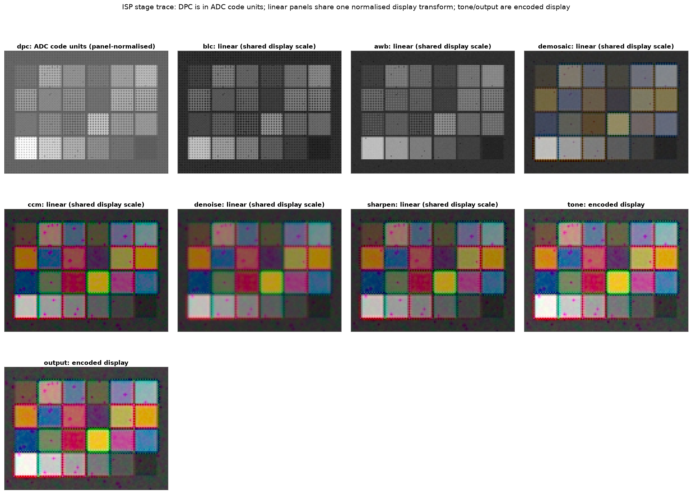
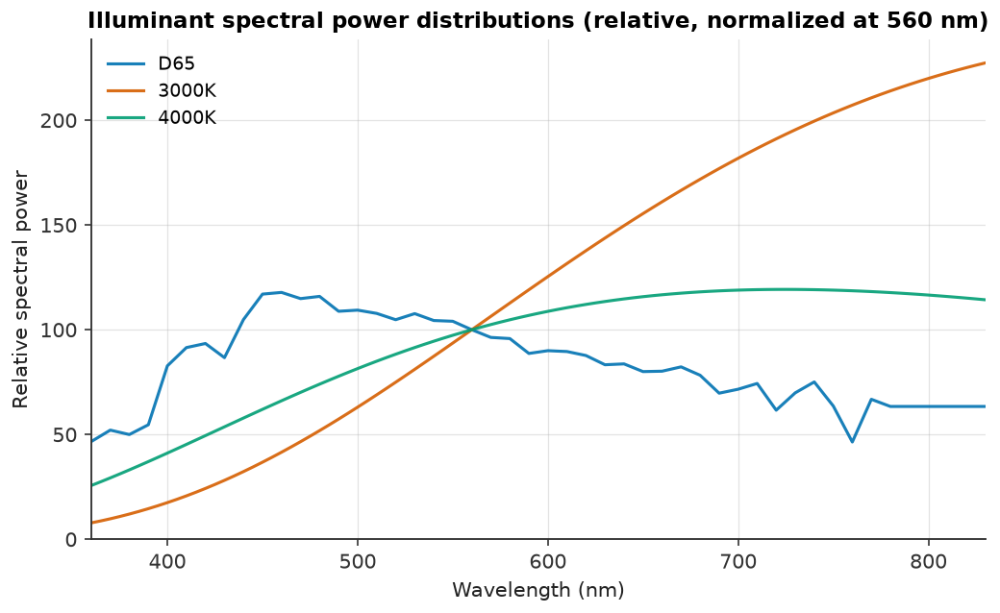
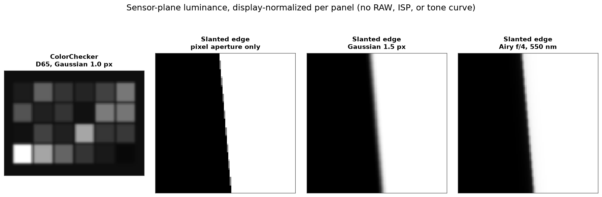
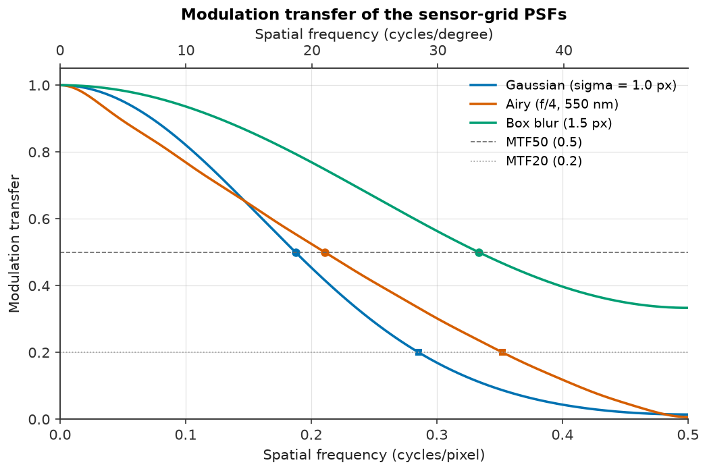
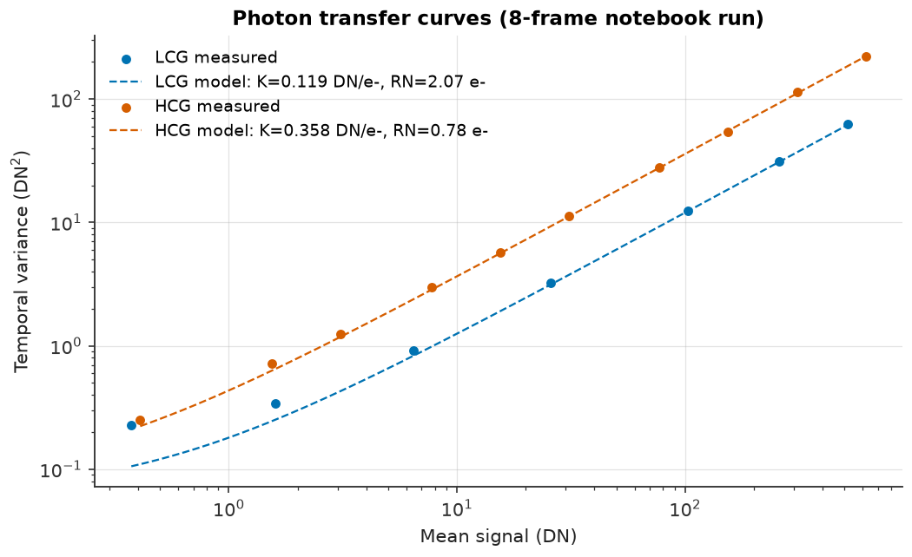
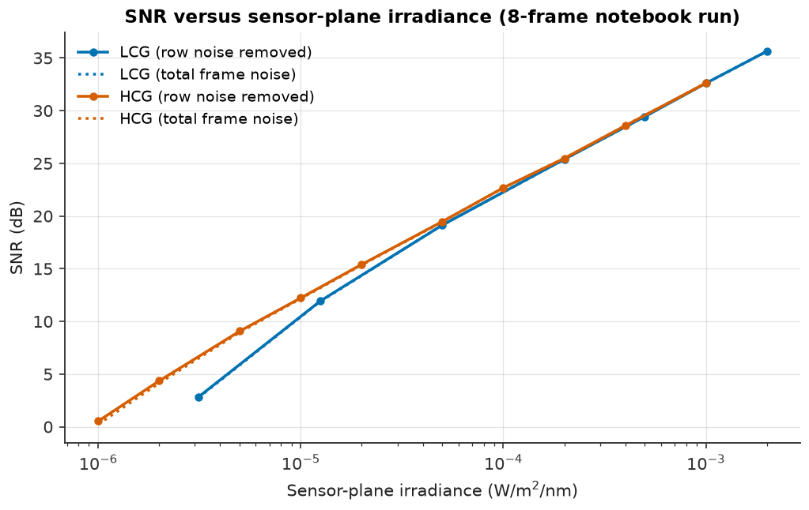
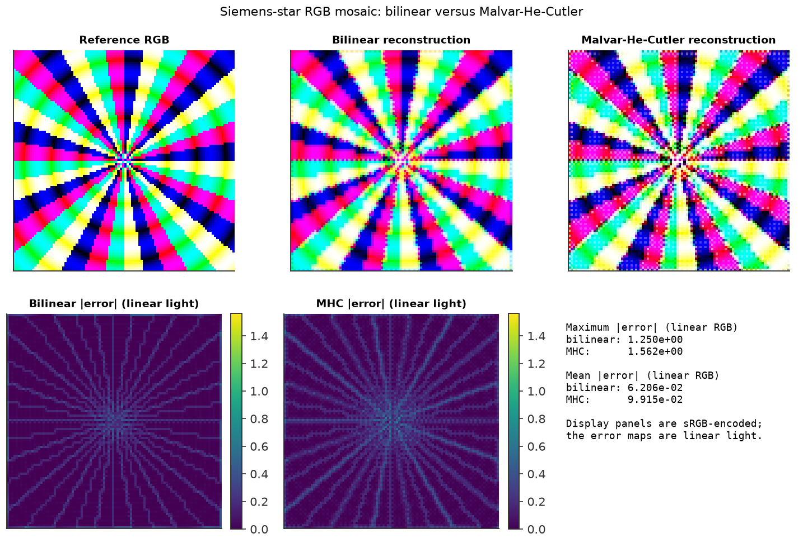
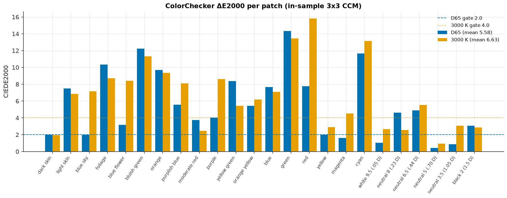
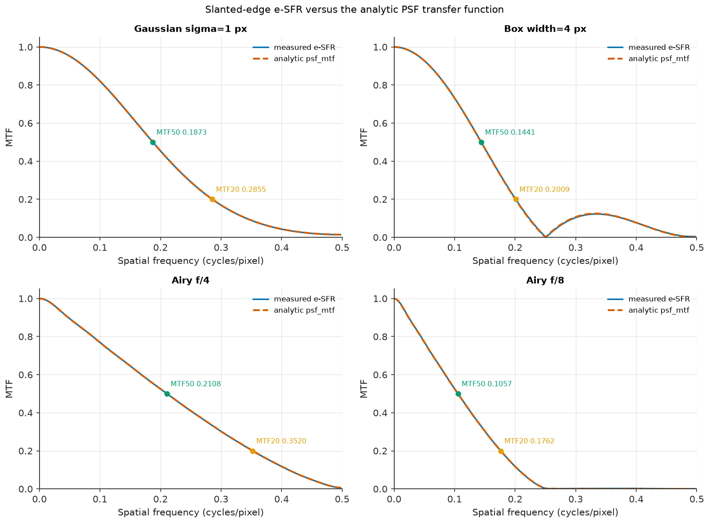
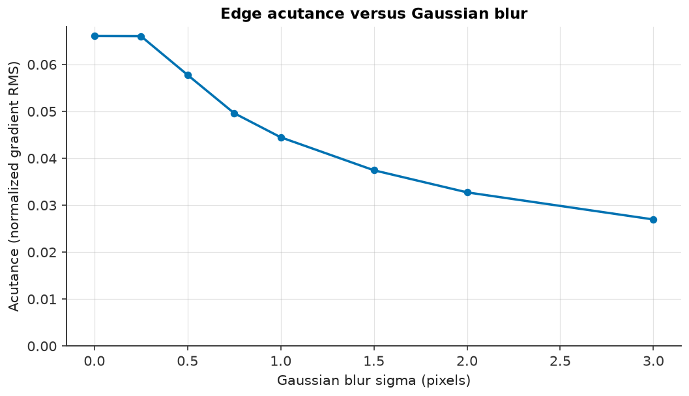

# camsim

<!-- Replace OWNER with the GitHub account/org before the public release. -->
[](https://github.com/OWNER/camsim/actions/workflows/ci.yml)
[](https://github.com/OWNER/camsim/actions/workflows/docs.yml)
[](https://github.com/OWNER/camsim/actions/workflows/release.yml)
[](https://www.python.org/)
[](LICENSE)

Deterministic camera sensor and ISP simulation with image-quality metrics.

`camsim` models the imaging chain from spectral scene irradiance to a rendered
image, measures image quality with standard metrics, and studies how optics,
sensor noise, and ISP parameter choices affect machine-vision accuracy. It is
built for camera and ISP engineers, machine-vision engineers, and researchers
who need a reproducible, physically grounded testbed rather than a
notebook-only demo.

<p align="center">
  
</p>

> **Status: validated sensor/ISP/metrics core; G5 sign-off pending.** G1–G4
> are PASS with committed validation reports, all G5 cross-cutting checks pass,
> and the consolidated candidate is
> [`results/reports/validation_report.md`](results/reports/validation_report.md).
> The library is version `0.1.0.dev0` and is not yet tagged or published.
> Machine-vision code (`camsim.tasks`) is deliberately gated behind G5 and is
> not implemented.

## The pipeline

```text
scene reflectance × illuminant × lens
        │  (spectral, 360–830 nm, explicit units)
        ▼
sensor-plane spectral irradiance      camsim.scene.targets.render
        │
        ▼
RAW frame (uint16 + full metadata)    camsim.Sensor.expose
        │
        ▼
rendered image (float32, [0, 1])      camsim.ISP.process
        │  linear-space stages → tone/OETF (the only non-linear step)
        ▼
image-quality report (JSON-able)      camsim.metrics.measure_all
```

The sensor and ISP are the reusable core: they depend only on `camsim.core`, so
externally computed irradiance can enter at the sensor boundary without the
scene or optics helpers. The metrics layer is independent of every simulator
package and operates on arrays plus metadata.

## Features

**Scene and optics (supporting layer)**

- D65, 3000 K, and 4000 K illuminants on a validated 360–830 nm grid, with
  photometric normalization to lux.
- ColorChecker, slanted-edge, flat-patch, and Siemens-star targets; lens
  geometry, f-number, transmittance, and `cos⁴` vignetting.
- Gaussian, Airy, and box PSFs with exact discrete transfer functions.

**Sensor (`camsim.Sensor`)**

- QE, CFA, and IR-cut spectral projection from bundled package data; Bayer,
  RCCC, and monochrome CFAs.
- Dual conversion gain (LCG/HCG), Poisson shot noise, read/row noise, DSNU,
  PRNU, dark current with a temperature-doubling model, defects, and PDAF sites.
- Dead pixels have zero mean photoresponse, stuck pixels are pinned to the ADC
  white code, and hot pixels receive a temperature-dependent dark-current
  multiplier. The RAW frame carries the defect union, a separate hot-pixel
  mask, and the PDAF mask; DPC corrects all three defect classes.
- Programmable analog/digital gain, 10-bit ADC with black-level pedestal,
  analog or digital binning, and optional crosstalk models.
- Every frame records its seeds, mode, gains, temperature, masks, and a stable
  configuration hash; fixed-pattern maps are deterministic for a preset.
- `scene.render` and `Sensor.expose` estimate peak simulation memory before
  allocating a spectral cube and raise a clear error above the configurable
  budget (8 GiB default).

**ISP (`camsim.ISP`)**

- Fixed stage order: DPC → BLC → LSC → AWB → demosaic → CCM → denoise →
  sharpen → tone → output.
- Bilinear and Malvar-He-Cutler demosaicing, gray-world or manual white
  balance, ridge-fitted 3×3 colour matrices, lens-shading correction,
  edge-preserving denoise, unsharp masking, and sRGB/Display P3 output.
- Every linear stage runs in float32; only the tone curve and output OETF are
  intentionally non-linear. The colour-correction matrix's non-negativity
  clamp is the one bounded exception, and it is inactive on in-gamut data.
  Optional stage traces record each intermediate buffer.
- **The default preset's CCM is the identity.** It is a neutral baseline, not
  a colour-accurate profile: a default ColorChecker render is roughly 40 mean
  ΔE2000 at the preset's default exposure (about 11 when well exposed) versus
  about 0.9 with the fitted G3 matrix. Fit a matrix with
  `camsim.isp.ccm.fit_ccm` and supply it in `ccm.matrix` for colour work.

**Metrics (`camsim.metrics`)**

- ISO 12233-style e-SFR/MTF from slanted edges, with MTF50/MTF20 crossings in
  cycles/pixel and cycles/degree.
- Spatial and temporal SNR, per channel and luma; ΔE76 and ΔE2000 colour
  difference; edge acutance.
- Chart layouts for ColorChecker, flat patches, and slanted edges, plus a
  unified `measure_all` report that serializes to JSON.

**Validation and reproducibility**

- EMVA 1288-style characterization (read noise, DSNU, PRNU, full well,
  linearity, dynamic range, dark current) in `camsim.characterization`.
- Explicit `numpy.random.Generator` objects, recorded seeds and config hashes,
  no global RNG; bit-identical within one environment, tolerance-based across
  platforms.
- Phase gates G0–G4 with committed reports and figures; G5 human sign-off is
  pending; see [Validation](docs/validation.md).

## Installation

Python 3.11–3.13 is required.

With [uv](https://docs.astral.sh/uv/) (recommended):

```bash
git clone https://github.com/OWNER/camsim.git
cd camsim
uv sync --all-extras
```

pip/venv fallback:

```bash
python -m venv .venv
source .venv/bin/activate
python -m pip install --upgrade pip
pip install -e ".[all]"
```

Core dependencies are NumPy, SciPy, Pydantic v2, Matplotlib, Pillow, and
colour-science. Optional extras: `[ml]` (PyTorch, scikit-learn), `[tune]`
(Optuna), `[docs]`, `[dev]`, and `[all]`. PyPI publication is deferred to
v1.0.0; install from a checkout for now.

## Quickstart

This end-to-end example renders a slanted edge, exposes it on the flagship
sensor preset, runs the default ISP, and measures MTF and acutance. It runs
from the repository root after installation.

```python
import camsim
from camsim.config.io import PRESETS_DIR, load_isp, load_sensor
from camsim.metrics import measure_all
from camsim.scene.charts import slanted_edge_layout
from camsim.scene.targets import render

# 1. Spectral scene at the sensor plane: 256 x 256 pixels, 200 lux, D65.
scene = render(
    "slanted_edge",
    illuminant="D65",
    lux=200.0,
    shape=(256, 256),
    oversampling=2,
    seed=11,
)

# 2. Irradiance -> RAW: 10 ms exposure in low-conversion-gain mode.
sensor = camsim.Sensor(
    load_sensor(PRESETS_DIR / "sensors" / "flagship_phone_50mp.json"),
    seed=1,
)
raw = sensor.expose(scene.irradiance, exposure_s=0.01, mode="LCG", seed=7)

# 3. RAW -> rendered image through the fixed ISP chain.
image = camsim.ISP(load_isp(PRESETS_DIR / "isp" / "default.json")).process(raw)

# 4. Measure the supported metrics for this layout.
report = measure_all(image, slanted_edge_layout(shape=(256, 256)))

print(image.data.shape, image.color_space)
print(f"MTF50: {report.mtf.mtf50_cp:.3f} cycles/pixel")
print(f"acutance: {report.acutance:.3f}")
```

The scene configuration, exposure, and layout must agree on the sensor shape;
mismatches are rejected rather than silently resampled. For a colour workflow,
render `"colorchecker"`, build the matching layout with
`chart_layout_from_scene(scene)`, and pass it to `measure_all`; the helper uses
the scene's own painted cells and spectrally computed Lab reference, so the
shape and oversampling cannot drift. The shipped ISP preset has an identity
CCM, so its delta-E is a baseline, not a colour-accuracy claim: fit a matrix
with `camsim.isp.ccm.fit_ccm` and place it in `ccm.matrix`. See
[ISP stages](docs/isp_stages.md) and [Metrics](docs/metrics.md) for the full
walkthroughs.

Command-line checks:

```bash
camsim info
camsim validate src/camsim/config/presets/sensors/flagship_phone_50mp.json
camsim schema sensor
```

## Gallery

All figures are committed under `results/figures/` and regenerated by the
example scripts (`make figures`). They show the Phase 1–4 evidence, not a
calibrated commercial camera.

| | |
|---|---|
|  **Illuminants.** D65 and warm white on the 360–830 nm grid. |  **Scene render.** ColorChecker and slanted edge at the sensor plane. |
|  **Optics.** Gaussian, Airy, and box MTFs with MTF50/MTF20. |  **Sensor PTC.** Photon-transfer curve and system gain. |
|  **Sensor SNR.** Read-noise and shot-noise regimes. |  **ISP stages.** Each intermediate buffer, stage by stage. |
|  **Demosaicing.** Bilinear versus Malvar-He-Cutler on a star. |  **Colour error.** Per-patch ΔE2000 under D65 and 3000 K. |
|  **White balance.** Measured versus analytic gains. |  **RCCC baseline.** Monochrome-plus-red sensor output. |
|  **e-SFR.** Measured MTF against the analytic reference. |  **SNR vs lux.** Read-noise-limited to shot-noise-limited. |
|  **ΔE heatmap.** Per-patch colour error across a chart. |  **Acutance.** Sharpness proxy versus Gaussian blur. |

## Validation status

The measured values, tolerances, assumptions, and limitations live in the
phase reports; this README deliberately does not restate them.

| Gate | Scope | Status | Evidence |
|---|---|---|---|
| G0 | install, lint, typecheck, tests, docs | Green locally; CI workflows added, execution pending a push | [Validation](docs/validation.md) |
| G1 | scene, illuminants, optics | **PASS** | [`results/reports/g1_scene_optics.md`](results/reports/g1_scene_optics.md) |
| G2 | sensor model and EMVA characterization | **PASS** | [`results/reports/g2_sensor.md`](results/reports/g2_sensor.md) |
| G3 | ISP stages and pipeline | **PASS** | [`results/reports/g3_isp.md`](results/reports/g3_isp.md) |
| G4 | metrics harness | **PASS** | [`results/reports/g4_metrics.md`](results/reports/g4_metrics.md) |
| G5 | consolidated human sign-off | **Awaiting human sign-off** | [`results/reports/validation_report.md`](results/reports/validation_report.md) |

The validation is simulated: it is not a certified ISO 12233 or EMVA 1288
measurement, and the flagship preset is a representative engineering design
point, not a measurement of a specific commercial part. See
[Datasheet mapping](docs/datasheet_mapping.md) for how public datasheet
parameters become preset fields and which values are assumptions.

## Documentation

- [Concepts](docs/concepts.md) — the imaging chain, units, linear-space
  invariant, and determinism contract.
- [Architecture](docs/architecture.md) — package layout, data contracts, and
  dependency rules.
- [ISP stages](docs/isp_stages.md) — the fixed chain, every stage's role and
  parameters, traces, and MONO/RCCC behaviour.
- [Metrics](docs/metrics.md) — chart layouts, e-SFR, SNR, ΔE, acutance, and
  reports.
- [Validation](docs/validation.md) — gate evidence, measured results, coverage
  policy, and the G5 sign-off conditions.
- [Datasheet mapping](docs/datasheet_mapping.md) — datasheet parameters to
  validated JSON fields.
- [API reference](docs/api.md) — the public modules and types.
- [Release](docs/release.md) — the release checklist and versioning policy.

The MkDocs site is built from `docs/` with `uv run mkdocs build --strict` and
deployed to GitHub Pages by the Docs workflow.

## Development commands

The same commands back the Makefile targets and CI:

```bash
make setup        # uv sync --all-extras
make test         # uv run pytest
make lint         # ruff check + ruff format --check
make format       # ruff check --fix + ruff format
make typecheck    # uv run mypy src
make coverage     # pytest with coverage; fails below 90 %
make docs         # uv run mkdocs build --strict
make build        # uv build (wheel + sdist)
make notebooks    # execute Jupytext notebooks with a 120 s per-notebook timeout
make figures      # run examples with a 300 s per-example timeout
make coverage-whole  # whole-package coverage including camsim.viz
make gate         # lint, typecheck, tests, coverage, docs, and build
```

A single test can be run with
`uv run pytest tests/test_package.py::test_import_and_version -v`.

Benchmarks time the reference pipeline at 512 × 512, 128 × 128 in quick mode,
or 1024 × 1024 in the realistic large-frame case (1× oversampling, about 2.2 GiB
estimated peak):

```bash
uv run python benchmarks/benchmark_pipeline.py
uv run python benchmarks/benchmark_pipeline.py --quick
uv run python benchmarks/benchmark_pipeline.py --large
```

Timings are machine-specific and are printed, never committed as claims.
Full 50 MP spectral simulation is not supported at v0.1.0: the memory guard
rejects a 38 GB cube with guidance to reduce the grid or process externally.

The coverage gate is statement and branch coverage of the simulation, metrics,
and support modules: **91.73 % subject-module coverage** in this candidate.
**Whole-package coverage including `camsim.viz` is 83.55 %**, because the
plotting layer is exercised by the executed examples and notebooks that
generate the committed gallery rather than by unit tests. The 90 % threshold
applies to the numerical subject modules; the lower whole-package number is a
reviewed exception, not a hidden metric. See
[Validation](docs/validation.md) for the policy and the sign-off item.

## Release status

- Version: `0.1.0.dev0` (`src/camsim/_version.py` is the single source).
- No tag exists yet. `v0.1.0` is cut only after the G5 human sign-off.
- PyPI publication is deferred to v1.0.0; distribution builds are produced by
  `uv build` and checked with `twine check`.
- Tagged releases upload a wheel, sdist, and `SHA256SUMS` to a GitHub release
  through `.github/workflows/release.yml`.
- Before public release, replace the `OWNER` placeholder in the badges and
  repository links; the [release checklist](docs/release.md) tracks this item.

## Repository conventions

- `src/` layout; Apache-2.0; package and import name `camsim`.
- `uv` with a committed `uv.lock`; the project-local `.venv/` is gitignored.
- Notebooks are Jupytext percent-format `.py` files; `.ipynb` files are never
  committed.
- Stochastic routines use explicit NumPy generators and seeds; the pipeline is
  deterministic within one environment.
- Phase gates G0–G5 are documented in [docs/validation.md](docs/validation.md);
  no machine-vision code lands before the G5 human sign-off.
- Citation metadata lives in [CITATION.cff](CITATION.cff). The design spec
  lives at `docs/superpowers/specs/`. The superseded reference plan is kept in
  `docs/reference/` for provenance and is not part of the documentation site.

Read [CONTRIBUTING.md](CONTRIBUTING.md) before opening a pull request. The
project follows the [Contributor Covenant](CODE_OF_CONDUCT.md), records changes
in [CHANGELOG.md](CHANGELOG.md), and documents third-party material in
[THIRD_PARTY.md](THIRD_PARTY.md).

## License

Apache-2.0. See [LICENSE](LICENSE).
