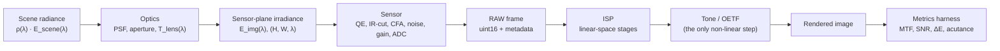

# Concepts

## The imaging chain



The sensor-plane irradiance is the key boundary. A user with an externally
computed spectral cube can bypass the scene and optics helpers and feed a
validated `SpectralIrradiance` directly into the sensor.

## Radiometry and units

Scene and image-plane quantities are spectral and carry explicit units. For a
Lambertian scene, the image-plane spectral irradiance is

```text
E_img(λ) = ρ(λ) · E_scene(λ) · T_lens(λ) / (4 N²) · cos⁴θ
```

Photometric normalization is explicit: when an illuminant is given in relative
units and a target illuminance in lux, the scene scales the SPD by

```text
E_scene(λ) = lux · SPD(λ) / (K_m · ∫ SPD(λ) · V(λ) dλ),   K_m = 683 lm/W
```

The sensor integrates photons over its spectral responses:

```text
electron_rate = ∫ QE(λ) · T_IR(λ) · T_CFA(λ) · E(λ) · A / (hc/λ) dλ
```

No stage is allowed to carry hidden unit ambiguity: field names include units,
and conversions are explicit functions.

## Spectral boundary

The sensor accepts irradiance at the sensor plane *before* its own spectral
filters (IR-cut, CFA, microlens). Supplying data that already includes the
IR-cut means configuring the sensor to disable it. The sensor never resamples
implicitly: spatial and wavelength resampling are explicit helper calls, with
energy-conserving averaging/integration and a clear error when the input does
not cover the sensor's wavelength range.

## Linear-space invariant

DPC, BLC, LSC, AWB, demosaic, CCM, denoise, and sharpen all operate in linear
float32. The tone curve and output transfer function (sRGB OETF or gamma) are
the only non-linear steps in reconstruction. Tests assert the invariant, for
example that scaling the linear input scales the pre-tone output.

## Determinism

Stochastic routines use explicit `numpy.random.Generator` objects, never a
global RNG. Fixed-pattern maps (defects, DSNU, PRNU, PDAF masks) are generated
from a pattern seed and reused; per-frame noise uses a per-call seed or a
deterministic stream. Within one environment and the same seeds, RAW output is
bit-identical. Across platforms, floating-point reductions may differ, so CI
uses tolerance-based golden tests.

## Metrics independence

`camsim.metrics` is a sibling of the simulation packages, not a submodule of the
sensor or ISP. It consumes arrays plus metadata (`ChartLayout`,
`ColorReference`) and must not import `camsim.sensor`, `camsim.isp`,
`camsim.scene`, or `camsim.optics`. An import-independence test enforces this.
