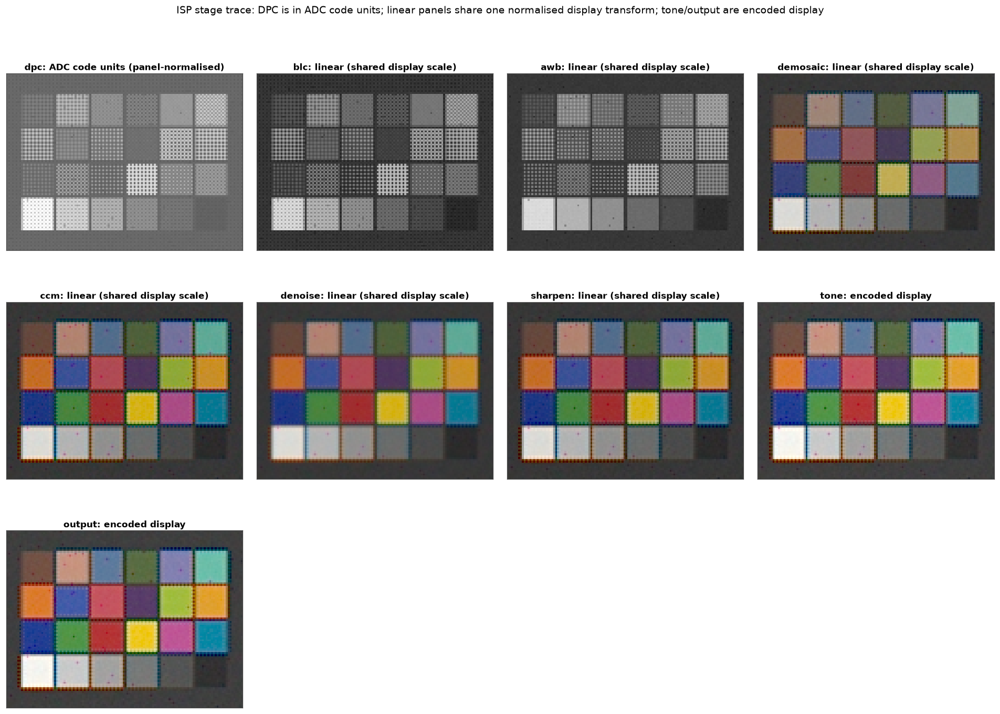

# camsim

Deterministic camera sensor and ISP simulation with image-quality metrics.

`camsim` is a professional Python library that simulates a camera from spectral
scene irradiance to a rendered image and measures image quality with standard
metrics. It is built for camera and ISP engineers, and researchers who need a
reproducible, physically grounded testbed. Rendered images and IQ reports can
feed downstream computer-vision or ML experiments.



*The default ISP applied to a spectral ColorChecker scene, shown stage by
stage: RAW, defect correction, black-level correction, lens shading, white
balance, demosaicing, colour correction, denoise, sharpen, and tone.*

## What's inside

1. **Simulation pipeline** — spectral scene and optics helpers, a rigorous
   sensor model (irradiance → RAW), and a modular ISP (RAW → rendered image).
   The reusable core is the sensor + ISP pair; neither depends on the scene or
   optics packages.
2. **Image-quality metrics** — an independent harness for e-SFR/MTF, SNR,
   colour error, and acutance. It operates on arrays plus metadata and never
   imports the simulator.
3. **Reproducible tooling** — camera orchestration, RAW/image IO, CLI commands,
   and validated presets that make every result repeatable.

## Install

With [uv](https://docs.astral.sh/uv/):

```bash
uv add camsim
```

Or with pip:

```bash
pip install camsim
```

For development:

```bash
git clone https://github.com/pengzhao-ai/camsim.git
cd camsim
uv sync --all-extras
```

pip/venv fallback:

```bash
python -m venv .venv
source .venv/bin/activate
python -m pip install --upgrade pip
pip install -e ".[all]"
```

## Quick check

```python
import camsim

print(camsim.__version__)
```

```bash
camsim info
```

## End-to-end example

```python
import camsim
from camsim.config.io import PRESETS_DIR, load_isp, load_sensor
from camsim.metrics import measure_all
from camsim.scene.charts import slanted_edge_layout
from camsim.scene.targets import render

scene = render("slanted_edge", lux=200.0, shape=(256, 256), oversampling=2, seed=11)
sensor = camsim.Sensor(
    load_sensor(PRESETS_DIR / "sensors" / "flagship_phone_50mp.json"), seed=1
)
raw = sensor.expose(scene.irradiance, exposure_s=0.01, mode="LCG", seed=7)
image = camsim.ISP(load_isp(PRESETS_DIR / "isp" / "default.json")).process(raw)
report = measure_all(image, slanted_edge_layout(shape=(256, 256)))

print(image.data.shape, image.color_space)
print(report.mtf.mtf50_cp, report.acutance)
```

## Where to go next

- [Concepts](concepts.md) — the imaging chain, units, linear-space invariant,
  and determinism contract.
- [Architecture](architecture.md) — package layout, data contracts, and
  dependency rules.
- [ISP stages](isp_stages.md) — every stage's role, parameters, trace, and
  linear-space invariant.
- [Metrics](metrics.md) — chart layouts, e-SFR, SNR, colour, acutance, and the
  unified report.
- [Validation](validation.md) — validation evidence, measured results,
  coverage policy, and reproduction commands.
- [Datasheet mapping](datasheet_mapping.md) — how preset fields trace to
  public specifications.
- [API reference](api.md) — the public modules and types.
- [Release process](release.md) — versioning and publishing policy.
