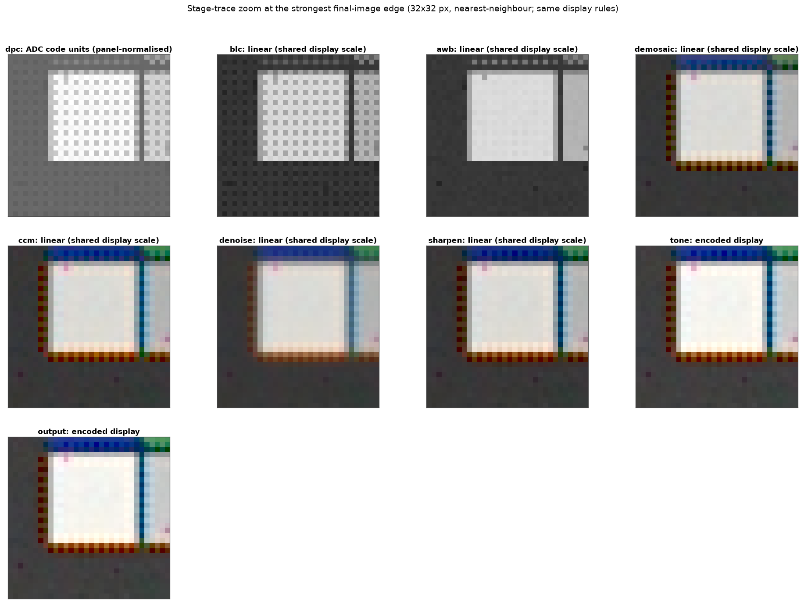
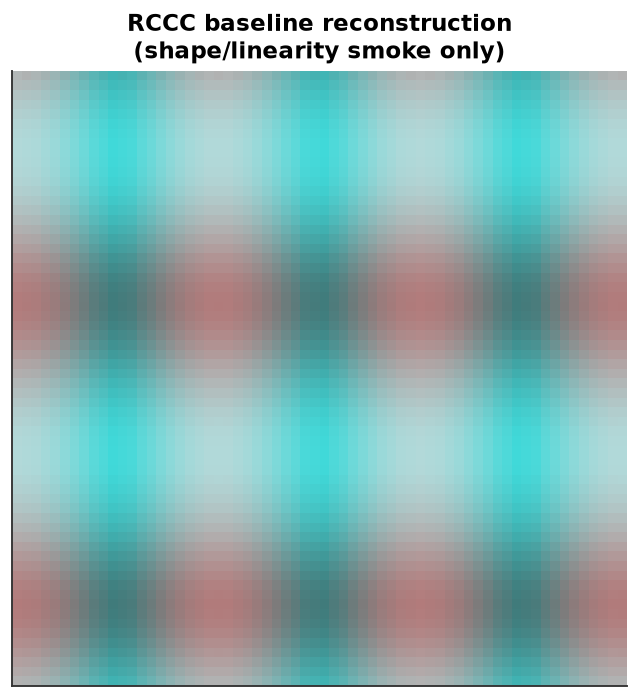
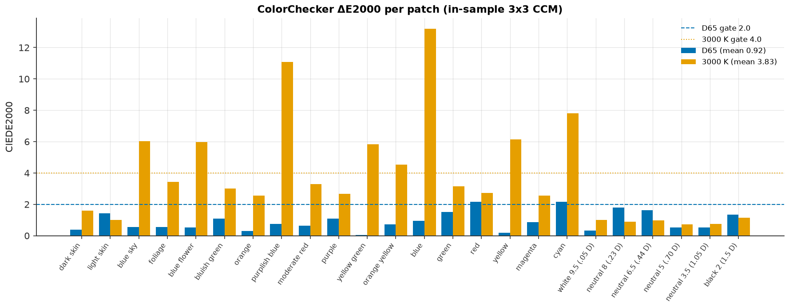

# ISP stages

The ISP turns a self-describing RAW frame into a display-referred
`RenderedImage`. It runs a **fixed chain**, configured by an `ISPConfig` preset
(`src/camsim/config/presets/isp/default.json` is the baseline):

```text
RAW codes
  → DPC      defective-pixel correction
  → BLC      black-level correction and white-span normalization
  → LSC      lens-shading correction
  → AWB      auto white balance
  → demosaic CFA → RGB
  → CCM      3×3 colour-correction matrix
  → denoise  luma/chroma noise reduction
  → sharpen  thresholded unsharp mask
  → tone     exposure trim, primaries, clamp, output OETF
  → output   display-referred image + metadata
```

Each stage has an `enabled` toggle, but **applicability is physical, not
configurable**: AWB and CCM run only on Bayer mosaics, demosaicing is skipped
for monochrome sensors, and RCCC sensors take a dedicated baseline
reconstruction. The colour stages raise rather than guess when a required
input (for example a CCM matrix) is missing.


*Stage-by-stage contact sheet from `examples/02_isp_stage_gallery.py`. Every
panel uses the same display normalization, so a black-level, white-balance, or
tone error remains visible instead of being hidden per panel.*

## The linear-space invariant

DPC, BLC, LSC, AWB, demosaic, CCM, denoise, and sharpen all operate on
**linear float32** values proportional to radiance. The tone stage is the first
non-linear step: it applies a linear exposure trim, a change of primaries when
Display P3 is selected, a display clamp, and the sRGB opto-electronic transfer
function. `RenderedImage.linear_rgb` keeps the matching unclipped pre-tone
buffer, while `RenderedImage.data` holds the display-encoded result in
`[0, 1]`.

That split matters for measurement. Metrics that estimate resolution or noise
consume `linear_rgb`; only the colour metric decodes `data`. Handing
display-encoded pixels to an MTF or SNR estimator biases the result through the
tone curve.

## Stage reference

| Stage | Config key | Main parameters | Trace metadata |
|---|---|---|---|
| Defective-pixel correction | `dpc` | `method`: `neighbor`, `median` | `method` |
| Black-level correction | `blc` | on/off only | `black_level_dn`, `white_span_dn`, `bit_depth` |
| Lens-shading correction | `lsc` | `mode`: `none`, `radial`, `flat_field`; `coefficients`, `map`, `center` | mode-specific parameters |
| Auto white balance | `awb` | `method`: `gray_world`, `white_patch`, `shades_of_gray`; `p`, `gains` | `gains`, `illuminant`, `method`, `confidence` |
| Demosaicing | `demosaic` | `method`: `bilinear`, `mhc` | `method`, `cfa` |
| Colour correction | `ccm` | `matrix`, `ridge`, `row_sum` | `matrix`, `ridge`, `row_sum` |
| Denoise | `denoise` | `method`: `gaussian`, `bilateral`; `luma_strength`, `chroma_strength`, `radius` | same parameters |
| Sharpen | `sharpen` | `amount`, `radius`, `threshold`, `luma_only` | same parameters |
| Tone | `tone` | `color_space`, `exposure_compensation_ev`, `gamma` | colour space, EV, gamma, transfer |
| Output | `output` | `color_space`, `bit_depth` | colour space, channels, bit depth |

### DPC — defective-pixel correction

A sensor's defect map flags dead, hot, and stuck pixels. DPC replaces those
samples from same-CFA neighbours (`neighbor`) or a local median (`median`), in
RAW code units before any black-level subtraction. The stage consumes the
`RawFrame.defect_mask` produced by the sensor, so a frame without a mask is an
identity operation. Replacing a pixel from the wrong CFA phase would blend
colours; the correction is therefore phase-aware.

### BLC — black-level correction

The ADC output includes a black-level pedestal (64 DN in the flagship preset).
BLC subtracts it and normalizes by the remaining white span:

```text
linear = (code - black_level_dn) / (2**bit_depth - 1 - black_level_dn)
```

After BLC, every later linear stage works in `[0, 1]` units. ADC saturation
maps to exactly 1.0; the division is not a clip because the sensor ADC already
clipped. Disabling BLC is a diagnostic mode that leaves the pipeline in code
units and makes absolute denoise/sharpen thresholds meaningless.

### LSC — lens-shading correction

Vignetting and microlens roll-off darken image corners. LSC multiplies the
linear image by a per-pixel gain from either a radial polynomial
(`mode="radial"`, coefficients plus optional `(row, column)` optical centre) or
a measured reciprocal flat field (`mode="flat_field"`). `mode="none"` skips the
stage even when `enabled` is true, because there is no correction to apply.
Gains are dimensionless and typically 1.0 at the centre rising to roughly
1.1–1.5 at the corner for a phone lens.

### AWB — auto white balance

A coloured illuminant leaves a cast because the RAW channels integrate the
scene through three fixed filters. AWB estimates one gain per channel and
applies the von Kries diagonal model, normalizing green to 1 so white balance
changes colour, not exposure. Estimators:

- `gray_world` — the scene average is achromatic; equalize channel means.
- `white_patch` — the brightest sample in each channel is a white surface.
- `shades_of_gray` — equalize Minkowski `p`-norms; `p=1` is gray-world,
  `p→∞` approaches white-patch, and the default `p=6` is a robust compromise.

Statistics are collected per CFA colour, never across the mosaic. AWB runs on
Bayer frames only; MONO has no colour to balance, and RCCC white balance is
deferred rather than guessed. Passing `awb.gains` pins known gains and skips
estimation. The recorded `confidence` falls as the required correction grows.


*Measured gray-world gains against the analytic expectation for D65 and
3000 K; the G3 report states the relative-error tolerances.*

### Demosaicing

A Bayer mosaic records one colour per site. `bilinear` interpolates each plane
independently; `mhc` (Malvar-He-Cutler, 2004) adds a gradient-dependent
correction from the green plane and reconstructs detail with the same 5×5
support. Bilinear is faster and shows zipper and false-colour artefacts on
edges; MHC is the baseline preset's default.

RCCC sensors use a dedicated `rccc_baseline` reconstruction (red plus clear
sites) regardless of `method`. Monochrome sensors skip demosaicing entirely and
produce a one-channel image.


*Bilinear and Malvar-He-Cutler reconstructions of a Siemens star against the
full-resolution reference.*

### CCM — colour correction

The camera's overlapping spectral sensitivities are not a colorimetric basis.
A 3×3 matrix maps linear camera RGB to linear output RGB, fitted **offline**
with `camsim.isp.ccm.fit_ccm` under an optional ridge penalty (`ridge`, default
`1e-4`) and a row-sum constraint (`row_sum`) that preserves neutrals. The
pipeline never fits at runtime because it has no reference target. A Bayer
frame with CCM enabled but no matrix raises.

The matrix is fitted on a specific illuminant and scene. Applying a D65 matrix
to a tungsten capture, or evaluating it on held-out patches, measures something
other than what was calibrated; the G3 report records the in-sample limitation.

### Denoise and sharpen

Denoise works in a linear luma/chroma opponent space after demosaicing, with
independent `luma_strength` and `chroma_strength` and a Gaussian or bilateral
filter of the given `radius`. Zero strengths are an identity operation, which
is why the baseline preset disables the stage: measurements should reflect the
optics and sensor, not an enhancement stage.

Sharpen applies a thresholded unsharp mask. `amount` scales the high-pass
contribution, `radius` sets the blur scale in pixels, `threshold` suppresses
low-contrast noise, and `luma_only` avoids chroma fringing. Both stages are
optional and are disabled in the baseline ISP preset.

### Tone and output

Tone is the only non-linear reconstruction step. It applies
`exposure_compensation_ev` in linear light, maps primaries to the configured
output space (`sRGB` or `DisplayP3`), clamps to `[0, 1]`, and applies the sRGB
OETF — or a plain power curve when `gamma` is set. The output colour space must
agree with the tone colour space; a disabled tone stage requires sRGB output.
`output.bit_depth` (8–16) records the intended container depth and does not
change the in-memory float range.

## Stage traces

`ISP.process(raw, trace=True)` returns a `RenderedImage` whose `stages` mapping
holds one `StageOutput` per executed stage, in pipeline order, plus a final
`"output"` entry. Each `StageOutput` carries the intermediate array, a
human-readable description, and stage metadata; `to_dict()` makes the trace
JSON-friendly.

```python
image = camsim.ISP(config).process(raw, trace=True)
for name, stage in image.stages.items():
    print(name, stage.data.shape, stage.description)
```

A trace is a set of immutable snapshots: later stages never mutate earlier
buffers. With `trace=False` (the default), `RenderedImage.stages` is `None` and
no trace arrays are allocated. The trace is the evidence behind the stage
contact sheet and the zoom crops below.



*Zoomed crops of the same scene after demosaicing, colour correction, and tone,
showing where detail and colour are actually reconstructed.*

## MONO and RCCC behaviour

| CFA | AWB | Demosaic | CCM | Output channels | Notes |
|---|---|---|---|---|---|
| Bayer `RGGB`/`BGGR`/`GRBG`/`GBRG` | yes, per CFA phase | `bilinear` or `mhc` | yes, matrix required | `(H, W, 3)`, `RGB` | full colour reconstruction |
| RCCC | skipped | `rccc_baseline` | skipped | `(H, W, 3)`, `RGB` | red plus clear sites; no Bayer CCM |
| MONO | skipped | skipped | skipped | `(H, W, 1)`, `MONO` | luminance only; colour metrics are skipped |



*RCCC baseline output: the reconstruction is deliberately simple, and the
pipeline records it as an RGB image so downstream metrics can still consume it.*

## Colour error after reconstruction



*Per-patch CIEDE2000 after the in-sample 3×3 CCM at D65 and 3000 K. The metric
and its limitations are described on the [Metrics](metrics.md) page; the full
measured values are in `results/reports/g3_isp.md`.*

## Reproducing this page

```bash
uv run python examples/02_isp_stage_gallery.py
uv run pytest tests/test_isp_pipeline.py tests/test_example_02.py -v
uv run jupytext --to ipynb --execute notebooks/02_isp_color_fundamentals.py \
  --output /tmp/02.ipynb
```

The figures above are copies of committed files under `results/figures/`; the
full list and measured values are in the G3 report. The validation is
simulated, not a certified measurement of a commercial ISP.
