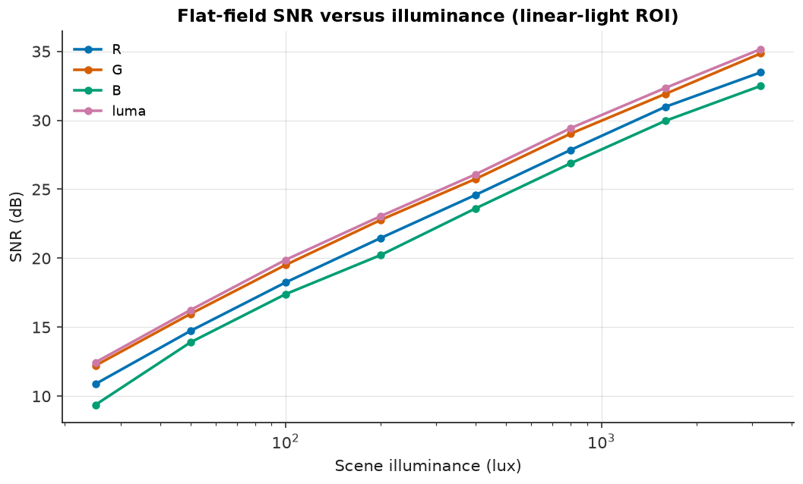
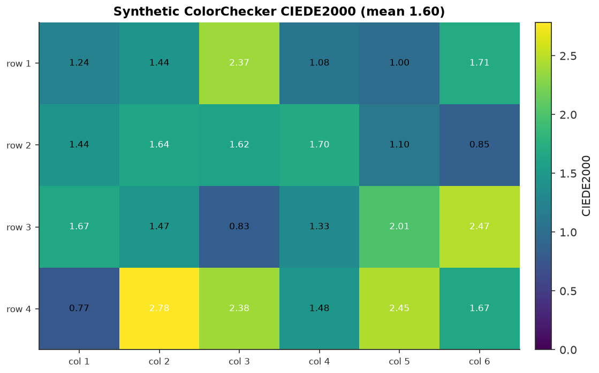

# Metrics

`camsim.metrics` is the independent image-quality harness. It operates on
arrays plus metadata and **never imports** `camsim.sensor`, `camsim.isp`,
`camsim.scene`, or `camsim.optics`; an import-independence test enforces that
rule. The scene layer owns convenience constructors that bind a chart to its
spectrally computed reference, and those constructors return the metrics-layer
`ChartLayout`, so the dependency runs scene → metrics, never the reverse.

The metrics answer four questions:

| Question | Metric | Entry point |
|---|---|---|
| How much detail survives? | e-SFR / MTF50 / MTF20 | `slanted_edge_mtf` |
| How noisy is a patch? | spatial and temporal SNR | `snr_patch`, `snr_temporal`, `snr_channels` |
| How wrong is the colour? | ΔE76 and ΔE2000 | `delta_e_patches`, `linear_rgb_to_lab` |
| How sharp is an edge? | normalized RMS gradient | `edge_acutance` |

## Chart layouts

A `ChartLayout` is the measurement plan: it names the rectangular regions to
measure, an optional edge region, the camera's pixel pitch and focal length,
and, for colour charts, the per-patch Lab ground truth.

- Regions are **sensor pixels**, never the oversampled rendering grid;
  measuring the scene grid would overstate resolution by the oversampling
  factor.
- A `PatchROI(x, y, width, height)` is **half-open**, matching NumPy slicing
  `image[y : y + height, x : x + width]`. Touching regions share no pixel and
  overlapping regions are rejected.
- `extract_patch` returns a view of one region without copying; metrics copy
  what they need.

Three constructors live in `camsim.scene.charts` because building a chart
layout needs reflectance spectra, an illuminant, and the CIE observer:

| Constructor | Layout | Use |
|---|---|---|
| `colorchecker_layout(illuminant, lens, shape, oversampling, pixel_pitch_um)` | 24 named patches + Lab reference | colour difference and per-patch SNR |
| `flat_patch_layout(shape, pixel_pitch_um, focal_length_mm)` | one full-frame `"flat"` patch | SNR, shading, fixed-pattern measurements |
| `slanted_edge_layout(shape, pixel_pitch_um, focal_length_mm)` | one centred half-size `"edge"` region | e-SFR and acutance |

The ColorChecker layout reuses the renderer's own cell geometry and ROI
derivation at the same shape and oversampling, so a ROI never straddles a
painted patch boundary. The reference is bound to the requested illuminant
(`"D65"`, `"3000K"`, or `"4000K"`); an unknown illuminant raises rather than
silently falling back to D65. Flat-patch and slanted-edge layouts carry no
reference because they measure noise and resolution, not colour.

## e-SFR and MTF

A slanted edge is the ISO 12233 structure for estimating resolution from one
image. The tilt lets the analysis reconstruct every sub-pixel phase of the
transition; the derivative of the edge-spread function is the line-spread
function, and the normalized magnitude of its Fourier transform is the MTF.

```python
from camsim.metrics import slanted_edge_mtf

result = slanted_edge_mtf(linear_edge_plane, pixel_pitch_um=1.12)
print(result.mtf50_cp, result.mtf20_cp, result.edge_angle_deg)
```

Key properties:

- The input must be **linear light** and contain exactly one edge. A
  display-encoded edge is biased by the tone curve.
- `oversampling` is the number of analysis samples per pixel (default 4). The
  G4 gate uses 8 because four carries roughly a 2 % MTF50 bias for
  near-diffraction-limited systems.
- `window="hamming"` tapers the LSF and suppresses rectangular-window
  sidelobes.
- MTF50/MTF20 are the first frequencies where the curve falls to 0.5 and 0.2,
  in cycles/pixel; `nan` means the curve never reaches the level inside the
  measured band (a legitimate answer for a very sharp system, never invented).
- When `focal_length_mm` is supplied, crossings are also reported in
  cycles/degree from the angular pixel pitch.
- For a Bayer RAW frame, `extract_raw_plane(raw, "G")` selects one phase and
  returns the pitch multiplier (`2.0` for Bayer, `1.0` for mono).


*Measured e-SFR against the exact transfer function of the known PSF, with the
MTF50 and MTF20 crossings marked. The analytic reference and the metric share
no measurement code.*

The implementation follows the standard's principles but is **not a certified
ISO 12233 measurement**, and the input here is simulated.

## SNR

SNR is reported as `20 log10(mean / std)` in linear light.

**Spatial SNR** (`snr_patch`) measures one frame. It includes fixed-pattern
variation because any static pixel-to-pixel difference enters the standard
deviation. It accepts a mono or colour image and one channel (RGB plane, Rec.
709 luma, or mono).

**Temporal SNR** (`snr_temporal`) measures a stack of at least two frames of a
static scene. It pools per-pixel temporal variances, so static fixed-pattern
variation is excluded from the noise estimate while still entering the mean.
Motion, flicker, or a drifting exposure enters the variance as if it were
noise.

**Per-channel SNR** (`snr_channels`) returns `R`, `G`, `B`, and `luma` for a
colour patch, or `"mono"` for a single plane, in deterministic order. A flat,
black, negative-mean, or single-pixel patch reports `valid=False` with
`snr_db=nan` rather than omitting the measurement.

Values must be linear light with the black-level pedestal already subtracted:
the pedestal raises the mean without changing the std and therefore inflates
SNR.



*The shipped sensor and ISP at fixed exposure from 25 to 3200 lux, showing the
transition from read-noise-limited to shot-noise-limited behavior. The sweep
is a gallery illustration, not a G4 gate check.*

## Colour difference

`delta_e_patches` measures CIEDE2000 and CIE76 between a display-encoded image
and a reference. The pipeline is: validate the display image, decode it with
the exact sRGB EOTF, average each patch in **linear** light,
`linear_rgb_to_lab` with the reference white point (Bradford-adapting from the
display's D65 white), then compare with the matching reference row.

A reference is mandatory. When none is attached to the layout, the metric
raises for a colour-chart layout; there is no implicit D65 fallback, because a
reference that does not match the illuminant turns a white-point error into an
apparent sensor colour error. `ColorReference` lives in `camsim.core.color`, so
the scene layer can compute it spectrally and the metrics layer can consume it
without importing the scene.

`delta_e_patches` returns per-patch rows plus the means over valid patches and
a validity flag. ΔE76 and ΔE2000 are both always computed, so a report can
compare the perceptually uniform metric with the simpler Euclidean one.



*Per-patch ΔE2000 for a synthetic ColorChecker-like measurement vehicle. The
chart is built from the spectrally computed reference plus a deterministic
perturbation; it is not a camera render and its ΔE is not a camera
colour-accuracy claim.*

## Acutance

`edge_acutance(image, roi)` is the contrast-normalized RMS gradient of one edge
ROI: it reduces RGB to Rec. 709 luma, maps the profile to `[0, 1]`, and returns
`sqrt(mean(gx**2 + gy**2))`. Higher is sharper, and the normalization makes it
invariant to exposure and chart contrast.

It is a **correlation-study sharpness proxy, not a calibrated physical
quantity** and not a standard definition. Its magnitude depends on ROI size,
and noise, compression, and sharpening halos all raise it. Use e-SFR for a
resolution measurement.


*Acutance falls as a Gaussian blur widens. The curve is monotonic but not a
calibrated MTF.*

## The unified harness

`measure_all(image, layout, reference=None)` measures every group the image and
layout support and returns a frozen `MetricReport`:

- `mtf` and `acutance` when the layout has an `edge_roi`;
- `snr` per patch when the layout has patches (per channel and luma for RGB,
  one plane for MONO);
- `color` when the image is RGB, the layout has patches, and a reference is
  available.

Groups that do not apply are `None`, and `metadata["skipped"]` records the
reason in a fixed order (MTF, acutance, SNR, colour), so repeated measurement
is deterministic. Resolution and noise consume `RenderedImage.linear_rgb` when
present; colour decodes `RenderedImage.data`. Neither the image nor the layout
is modified.

The expected companion layout for a rendered slanted edge is
`slanted_edge_layout(shape=...)`; for a rendered ColorChecker use
`colorchecker_layout(illuminant=..., shape=..., oversampling=...)` at the same
shape and oversampling as the render.

### JSON reports

`MetricReport.to_dict()` expands the nested dataclasses into a JSON-friendly
mapping; `to_json()` serializes it with `allow_nan=False`, converting NaN
crossings and undefined ratios to `null`. NumPy scalars and tuples become plain
Python values. The G4 gate's committed
`results/reports/g4_metrics_results.json` is the gate's measurement payload,
not a serialized `MetricReport`; its `measure_all.serialization` section
records the serialization checks as booleans.

```python
report = measure_all(image, layout)
text = report.to_json()
print(report.layout_id, report.metadata["skipped"])
```

## Import independence

`camsim.metrics` may depend on `camsim.core` and on nothing else from the
simulator. `tests/test_metrics_independence.py` imports the package in a fresh
subprocess and asserts that `camsim.sensor`, `camsim.isp`, `camsim.scene`, and
`camsim.optics` are absent from `sys.modules`. The scene-owned layout
constructors are the sanctioned bridge in the other direction.

## Reproducing this page

```bash
uv run python examples/03_measure_iq.py
uv run pytest tests/test_metrics_mtf.py tests/test_metrics_snr.py \
  tests/test_metrics_color.py tests/test_metrics_summary.py \
  tests/test_metrics_independence.py tests/test_example_03.py -v
uv run jupytext --to ipynb --execute notebooks/03_measuring_iq.py \
  --output /tmp/03.ipynb
```

The figures above are copies of committed files under `results/figures/`. The
measured values, tolerances, assumptions, and limitations are in the G4 report,
`results/reports/g4_metrics.md` (a repository artifact, not a page on this
site).

## Limitations

- This is a **simulated** validation. The e-SFR follows ISO 12233 principles
  but is **not certified** against the standard, and the sensor/ISP numbers
  come from a representative engineering preset, not a commercial part.
- The analytic MTF references are **ideal** Gaussian, box, and Airy kernels:
  no aberrations, field-dependent blur, or wavelength-dependent PSF.
- The SNR gate cases use **Gaussian noise in linear light**, not Poisson shot
  noise from the sensor, to isolate the estimator from the sensor model.
- An ideal synthetic edge has no finite MTF50/MTF20; the report records `null`
  and never invents a crossing.
- The synthetic ColorChecker-like chart is a **measurement vehicle**, not a
  camera render; colour-metric results on it are not a camera colour-accuracy
  claim.
- Acutance is a relative sharpness proxy; compare only measurements with the
  same ROI geometry.
