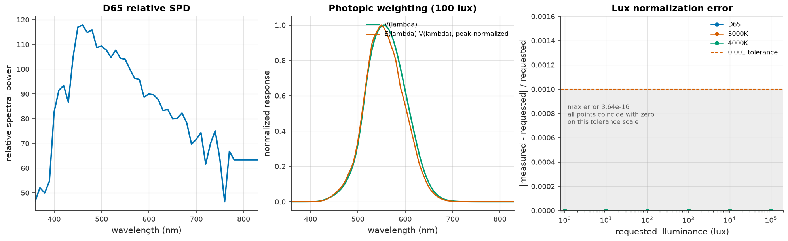
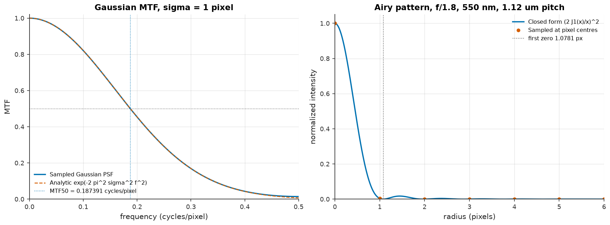
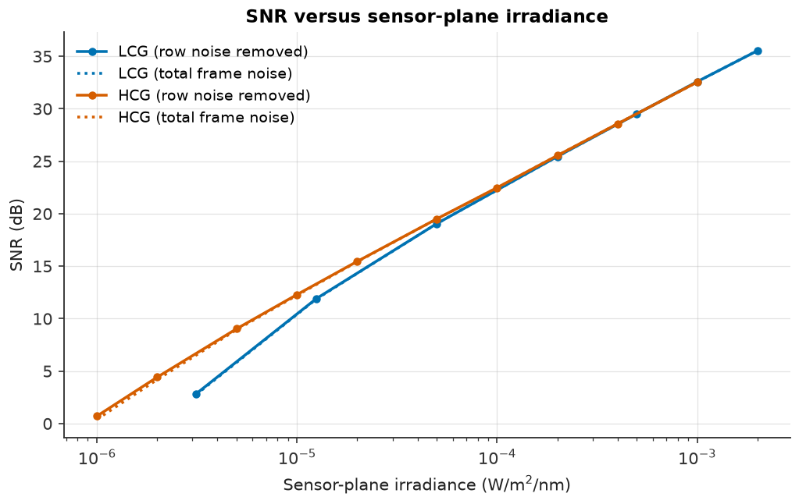
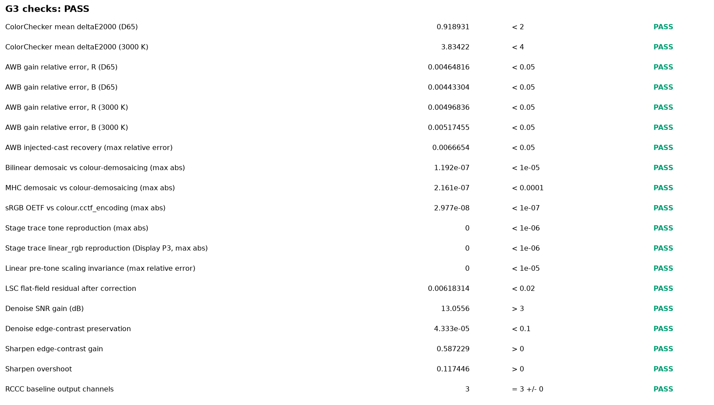
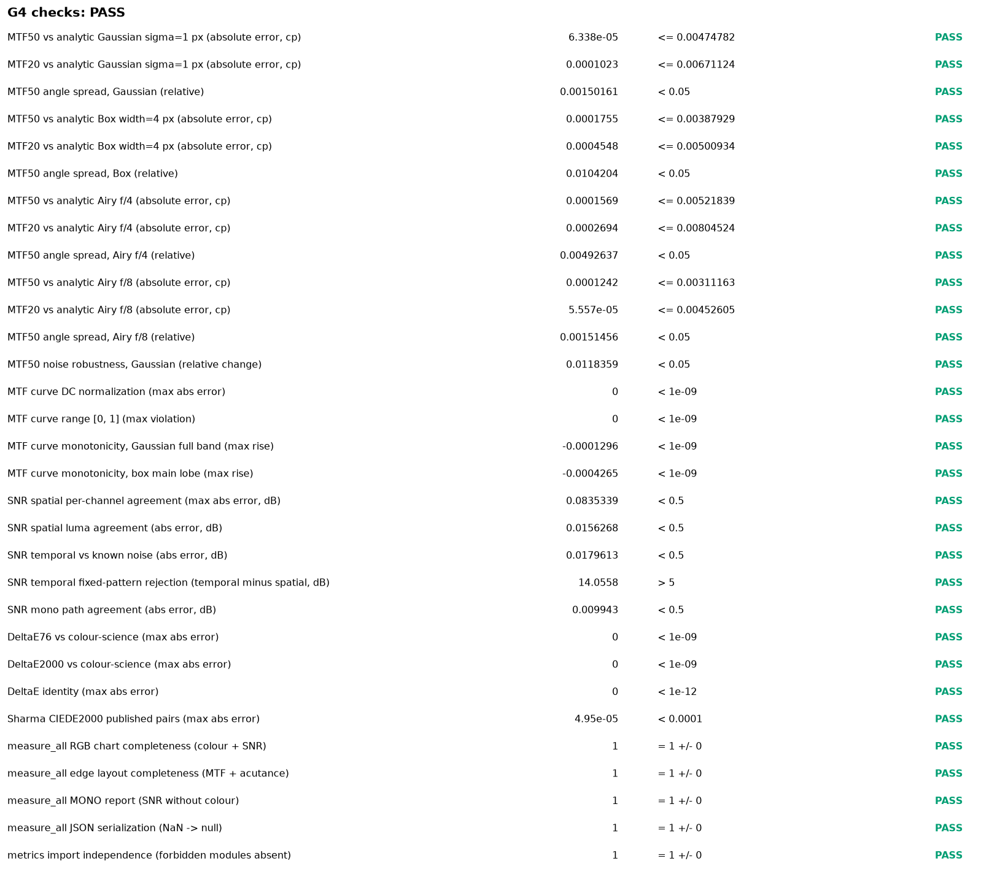
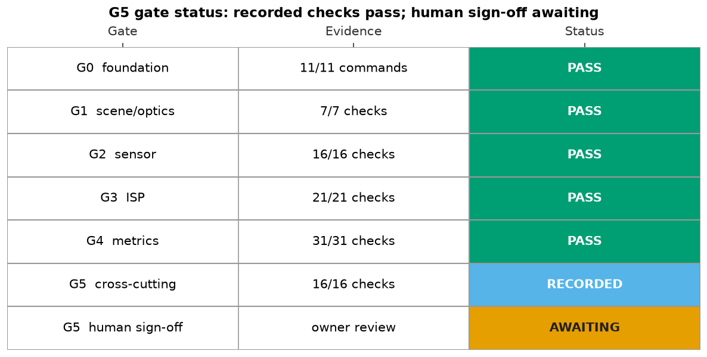
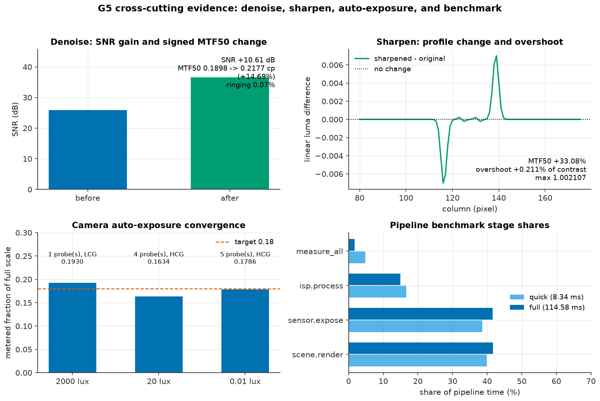

# Validation

This page is the public index of camsim's phase-gate evidence. The
**sensor/ISP/metrics core is validated**: G1–G4 are PASS with committed reports,
all G5 cross-cutting checks pass, and the **G5 human sign-off is pending**. A
gate is not marked green until its report is reproducible from a clean
checkout; the consolidated candidate is
`results/reports/validation_report.md` in the repository.

## Lines of evidence

Every gate draws on four independent lines of evidence, so a bug must survive
more than one perspective before it can hide:

1. **Analytic invariants** — units and dimensional consistency, energy
   conservation, linear electron scaling with lux and exposure, Poisson
   variance in the shot-noise regime, clipping at full well and ADC saturation,
   known-PSF MTF, the sRGB OETF, and colour-difference identities.
2. **Round-trip characterization** — configure known sensor parameters, run
   EMVA 1288-style characterization, and recover the parameters within a stated
   tolerance.
3. **Reference-library cross-checks** — bilinear and Malvar-He-Cutler
   demosaicing against `colour-demosaicing`; colour transforms and ΔE against
   `colour-science`; filtering against `scipy` and `scikit-image`.
4. **Datasheet plausibility** — the flagship preset reproduces SNR, dynamic
   range, full well, and read noise within the ranges implied by public
   specifications, with assumptions listed explicitly.

Tolerances are stated per check in the phase report. Determinism is promised
within one environment (same OS, Python, NumPy, and SciPy); cross-platform
comparisons use tolerances because floating-point reduction order may differ.

## Gate status

| Gate | Phase | Scope | Evidence | Measured / passed | Status |
|---|---|---|---|---|---|
| G0 | 0 | install, lint, typecheck, tests, docs build | this page; `.github/workflows/ci.yml` | 11/11 commands | **PASS** (local gate run) |
| G1 | 1 | scene, illuminants, optics | `results/reports/g1_scene_optics.md` | 7/7 checks | **PASS** |
| G2 | 2 | sensor model and EMVA characterization | `results/reports/g2_sensor.md` + `g2_sensor_results.json` | 16/16 checks | **PASS** |
| G3 | 3 | ISP stages and pipeline | `results/reports/g3_isp.md` + `g3_isp_results.json` | 21/21 checks | **PASS** |
| G4 | 4 | metrics harness | `results/reports/g4_metrics.md` + `g4_metrics_results.json` | 31/31 checks | **PASS** |
| G5 | 5 | consolidated cross-cutting evidence and human sign-off | `results/reports/validation_report.md` | 16/16 cross-cutting checks; sign-off pending | **Awaiting human sign-off** |

## Coverage policy

The coverage gate enforces **at least 90 % statement and branch coverage** with:

```bash
uv run pytest --cov=camsim --cov-fail-under=90
```

`pyproject.toml` configures `[tool.coverage.run]` with an explicit omit for
`*/camsim/viz/*`. The presentation layer is plotting code: it is exercised by
the example scripts and notebooks that generate the committed gallery, not by
the unit suite. Its correctness is judged by executed examples, while the
simulation, metrics, configuration, characterization, IO, camera, and CLI
modules — the code whose numbers the gates depend on — must meet the 90 %
threshold. The same command is the Makefile `coverage` target and the CI test
command; a release must not lower the threshold or delete tests to pass it.

Coverage is reported with two explicit scopes, never one headline number:

| Scope | Measured | Gate |
|---|---:|---|
| Subject modules (viz omitted, branch) | **91.73 %** | ≥ 90 % |
| Whole package including `camsim.viz` (branch) | **83.55 %** | reviewed exception |

The whole-package figure is measured with `coverage-whole.rc` (or
`make coverage-whole`), which does not omit viz. It is lower because the
plotting layer is exercised by the executed examples and notebooks, not by the
unit suite. The owner accepts this exception at sign-off; 91.73 % is not called
"total coverage".

`tests/test_docs_smoke.py` additionally checks that the README gallery paths,
documentation nav, `docs/images` mirror, API/release pages, and workflows exist;
that the documented quickstart pipeline runs; and that the benchmark's
`--quick` mode passes.

## Gate figures

The documentation site carries copies of selected committed figures so each
gate is visible without leaving the site. The originals and the full set live
under `results/figures/`; the reports carry the measured values and
tolerances.

| Gate | Figure |
|---|---|
| G1 |  *Lux normalization across illuminants and 1–100,000 lux.* |
| G1 |  *Gaussian, Airy, and box PSFs with their transfer functions.* |
| G2 |  *LCG/HCG photon-transfer curves and system gain.* |
| G2 |  *SNR versus irradiance across the shot- and read-noise regimes.* |
| G3 |  *G3 check summary with tolerances.* |
| G4 |  *G4 check summary with analytic references.* |
| G5 |  *Gate/check status matrix; G5 remains awaiting human sign-off.* |
| G5 |  *Denoise, sharpen, auto-exposure, and benchmark evidence.* |

## G0 — Foundation

The Phase 0 gate proves that a fresh environment can install, lint, type-check,
test, and document the package. Reproduce it from the repository root:

```bash
uv sync --all-extras
uv run pytest -q
uv run ruff check .
uv run ruff format --check .
uv run mypy src
uv run mkdocs build --strict
uv run python -c "import camsim; print(camsim.__version__)"
```

Expected: the suite passes, lint and formatting are clean, mypy reports no
issues under `strict`, the documentation builds with warnings treated as
errors, and the version prints `0.1.0.dev0`. The executable form of this gate
is `tests/test_ci_config.py` plus the CI workflows, and `make gate` runs the
same commands locally.

## G1 — Scene and optics

**Status: PASS (green locally).** The full report is
`results/reports/g1_scene_optics.md`; its four figures are
`results/figures/g1_lux_normalization.png`, `g1_psf_mtf.png`,
`g1_energy_conservation.png`, and `g1_edge_angle.png`. The report is generated
deterministically by `benchmarks/g1_scene_optics.py`, and
`tests/test_validation_g1.py` is the executable form of the gate.

Reproduce from the repository root:

```bash
uv run python benchmarks/g1_scene_optics.py
uv run pytest tests/test_validation_g1.py -v
uv run pytest tests/test_validation_g1.py tests/test_units.py \
  tests/test_spectral.py tests/test_lens.py tests/test_psf.py \
  tests/test_targets.py tests/test_propagation.py tests/test_glyphs.py -v
uv run pytest -q
uv run ruff check . && uv run mypy src
```

Measured results against the G1 tolerances:

| Check | Measured | Tolerance | Result |
|---|---|---|---|
| Photometric normalization (`683 * integral E(lambda) V(lambda) dlambda`, dlambda in nm) | max relative error 3.64e-16 over D65/3000 K/4000 K and 1-100,000 lux | < 1e-3 | PASS |
| Gaussian PSF MTF50, sigma = 1 px | 0.187391 cycles/pixel | within 0.01 of 0.1874 | PASS |
| Airy first zero, reference f/1.8 lens | 1.07810 px | within 1e-3 of 1.078 px; kernel matches `x = pi r / (lambda N / pitch)` within 1e-12 | PASS |
| Energy through PSF + 4x box mean | max relative error 8.88e-16 | < 1e-2 | PASS |
| Slanted-edge angle recovery | max absolute error 0.0426 deg | < 0.5 deg | PASS |
| Spectral cube/unit contract and resampling | 7/7 checks behaved as required | reject mismatches; conserve energy | PASS |
| Reference lens geometry | 83.677 deg diagonal FOV; 99.733 px/deg at 1.12 um | 84 +/- 1 deg; 99.73 +/- 0.1 % | PASS |

The report records these assumptions and known limitations:

- the optics layer is a **supporting model, not a calibrated lens**: ideal
  Gaussian, Airy, and box kernels with no aberrations, wavelength-dependent
  PSF, polychromatic diffraction, or field-dependent blur;
- **ISO 12233-style e-SFR is deferred to G4**; G1 validates only the
  target/estimator edge-angle convention;
- **D65 endpoint extrapolation**: `colour-science` tabulates D65 to 780 nm and
  camsim holds that value constant to 830 nm; V(lambda) is about 1.5e-5 at
  780 nm, so the photometric effect is far below the 1e-3 tolerance;
- the **photometric integral covers 360-830 nm**, with V(lambda) zero outside
  the CIE table by contract;
- the **reference lens** uses scalar transmittance 0.9, no vignetting, and a
  83.68 deg field that rounds to the documented approximately 84 deg;
- **energy conservation** is a round-off-level statement for symmetric kernels
  with reflected borders; asymmetric kernels carry the documented 1 % budget;
- **determinism** is promised within one environment; PNG bytes can differ
  across Matplotlib/font builds, so cross-platform checks compare the reported
  numbers with tolerances.

## G2 — Sensor model and EMVA characterization

**Status: PASS (green locally).** The full report is `results/reports/g2_sensor.md`,
its machine-readable results are `results/reports/g2_sensor_results.json`, and
its six figures are `results/figures/g2_qe_cfa_ir_cut.png`, `g2_ptc.png`,
`g2_snr_vs_irradiance.png`, `g2_dark_current_vs_temperature.png`,
`g2_lcg_hcg_comparison.png`, and `g2_dsnu_prnu_histograms.png`. The report is
generated by `examples/04_emva_characterization.py`;
`tests/test_preset_validation.py` is the executable form of the flagship G2
recovery gate.

Reproduce from the repository root:

```bash
uv run pytest tests/test_sensor.py tests/test_noise.py tests/test_defects.py \
  tests/test_gain.py tests/test_adc.py tests/test_characterization.py \
  tests/test_preset_validation.py -v
uv run pytest -q
uv run ruff check . && uv run ruff format --check . && uv run mypy src
uv run python examples/04_emva_characterization.py
```

Measured results against the G2 tolerances (32 frames per level, 10 ms
exposure, G2 LCG sweep with base seed 9; HCG low-to-saturation sweep with base
seed 3; 16 dark frames per temperature at 0.1 s with base seed 21):

| Check | Measured | Tolerance | Result |
|---|---|---|---|
| LCG read noise | 2.0264 e- rms | 2.0 +/- 5 % | PASS |
| LCG DSNU | 0.4775 e- | 0.5 +/- 10 % | PASS |
| LCG PRNU | 0.4993 % | 0.5 +/- 10 % | PASS |
| LCG saturation capacity | 5996.8 e- | 6000 +/- 10 % | PASS |
| LCG linearity residual | 4.19e-5 | < 0.05 | PASS |
| LCG dynamic range | 69.42 dB | 30-90 dB | PASS |
| LCG system gain relative error | 0.018 % | < 2 % | PASS |
| HCG read noise | 0.7211 e- rms | 0.7 +/- 5 % | PASS |
| HCG DSNU | 0.5031 e- | 0.5 +/- 10 % | PASS |
| HCG PRNU | 0.4971 % | 0.5 +/- 10 % | PASS |
| HCG saturation capacity | 2015.3 e- | 2000 +/- 10 % | PASS |
| HCG linearity residual | 7.33e-5 | < 0.05 | PASS |
| HCG dynamic range | 68.93 dB | 30-90 dB | PASS |
| HCG system gain relative error | 0.788 % | < 2 % | PASS |
| Dark current at 65 C (differential) | 60.68 e-/s | 61.80 +/- 5 % | PASS |
| Dark current at 70 C (differential) | 99.89 e-/s | 102.17 +/- 5 % | PASS |

The report records these assumptions and known limitations:

- the characterization is **simulated and EMVA 1288-style**, not a certified
  measurement of a physical sensor;
- the flagship preset is a **representative engineering design point**, not a
  measurement of a specific commercial part; the QE/CFA/IR-cut curves are
  synthetic estimates bundled in `camsim.data`;
- each PTC uses **one conversion-gain mode**; `auto` is resolved once because a
  mixed-mode PTC has no single slope;
- flat-field illumination is uniform, temperature is constant within a
  characterization, and the ADC is ideal and linear;
- LCG/DSNU and HCG read noise are **sub-LSB** (about 0.24-0.26 DN), so the fit
  uses the exact quantized forward model rather than a fixed 1/12 DN²
  correction;
- the **eight-frame LCG sweep** in `tests/test_characterization.py` is a
  robustness check with a documented 20 % DSNU waiver; the 32-frame result is
  the G2 evidence;
- **dark-current points below 60 C** are differential measurements compressed
  by the zero-charge clamp and sub-LSB ADC, so only 65 C and 70 C are
  gate criteria; those agree with the differential doubling model
  `D(T) - D(25 C)` within 1.8 % and 2.2 % under a 5 % tolerance;
- **determinism** is promised within one environment; cross-platform runs
  compare tolerances, not bit patterns.

## G3 — ISP stages and pipeline

**Status: PASS (green locally).** The full report is
`results/reports/g3_isp.md` (a repository artifact, not a page in the published
docs site); its machine-readable results are
`results/reports/g3_isp_results.json`, and its figures are
`results/figures/02_isp_stage_contact_sheet.png`,
`02_isp_stage_zoom.png`, `02_isp_demosaic_comparison.png`,
`02_isp_colorchecker_delta_e.png`, `02_isp_awb_gains.png`,
`02_isp_rccc_baseline.png`, `g3_delta_e.png`, `g3_awb_gains.png`, and
`g3_check_summary.png`. The artifacts are generated by
`examples/02_isp_stage_gallery.py`; `tests/test_example_02.py` is the
executable form of the gate. The stage contract is described on the
[ISP stages](isp_stages.md) page.

Reproduce from the repository root:

```bash
uv run python examples/02_isp_stage_gallery.py
uv run pytest tests/test_example_02.py -v
uv run jupytext --to ipynb --execute notebooks/02_isp_color_fundamentals.py \
  --output /tmp/02.ipynb
```

The full example exits non-zero when a gate check fails; the quick smoke run is
informational and always exits zero.

Measured results against the G3 tolerances (full run, 300 lux, 96 x 128
ColorChecker, 2x oversampling, flagship preset at LCG):

| Check | Measured | Tolerance | Result |
|---|---:|---|---|
| ColorChecker mean ΔE2000, D65 | 0.919 | < 2.0 | PASS |
| ColorChecker mean ΔE2000, 3000 K | 3.834 | < 4.0 | PASS |
| AWB R gain relative error, D65 | 0.465 % | < 5 % | PASS |
| AWB B gain relative error, D65 | 0.443 % | < 5 % | PASS |
| AWB R gain relative error, 3000 K | 0.497 % | < 5 % | PASS |
| AWB B gain relative error, 3000 K | 0.517 % | < 5 % | PASS |
| AWB injected-cast max relative error | 0.667 % | < 5 % | PASS |
| Bilinear demosaic max abs vs `colour-demosaicing` | 1.19e-7 | < 1e-5 | PASS |
| MHC demosaic max abs vs `colour-demosaicing` | 2.16e-7 | < 1e-4 | PASS |
| sRGB OETF max abs vs `colour-science` | 2.98e-8 | < 1e-7 | PASS |
| Stage-trace display reproduction max abs | 0 | < 1e-6 | PASS |
| Stage-trace `linear_rgb` reproduction max abs (Display P3) | 0 | < 1e-6 | PASS |
| Linear pre-tone scaling with AWB and CCM max relative error | 0 | < 1e-5 | PASS |
| CCM pre-clamp minimum on linearity data | 0.0248 | > 0 | PASS |
| LSC flat-field residual after correction | 0.618 % | < 2 % | PASS |
| Denoise SNR gain | 13.06 dB | > 3 dB | PASS |
| Denoise edge-contrast relative change | 4.3e-5 | < 10 % | PASS |
| Sharpen edge-contrast gain | 0.587 | > 0 | PASS |
| Sharpen positive overshoot | 0.117 | > 0 | PASS |
| RCCC baseline output | `(64, 64, 3)`, finite | 3 channels | PASS |

The ColorChecker criterion now passes because the shipped preset's CFA curves
were re-authored as synthetic conventional Bayer bands centred near 448 nm
(blue), 542 nm (green), and 610 nm (red) with moderate out-of-band leakage and
peak transmittance 0.86-0.91 (R 0.905, G 0.903, B 0.864). The superseded
broad, nearly collinear curves had a red/green correlation of 0.940 and left a
45.6 % Luther-condition residual,
so no 3x3 matrix could colour-correct them. The conventional bands reduce the
correlation to 0.187, the projection condition number to 1.56, and the
Luther-condition residual to 12.6 %, and the in-sample CCM fit RMS is about
0.008 linear RGB at both illuminants. The ΔE thresholds (2.0 / 4.0) were not
changed. The 3000 K mean is 3.834, 4.14 % below the 4.0 limit; the gate is
mean-only, with per-patch maxima reaching 13.208 (blue) and 11.077 (purplish
blue). The fit remains in-sample: it measures calibration-scene
representability, not held-out generalisation or colour constancy.

The report records these assumptions and known limitations:

- the validation is **simulated**; it is not a certified ISO 12233 or EMVA
  1288 measurement, and the preset is a representative engineering design
  point;
- the CCM is fitted and evaluated **in-sample** on the same 24 patches; it
  measures calibration-scene representability, not held-out generalisation or
  colour constancy;
- the ColorChecker CCM run uses **manual analytic perfect-diffuser AWB gains**
  so the row-sum CCM is neutral-preserving; the default gray-world estimator is
  validated separately on neutral flat fields and under an injected cast;
- **formal ISO 12233-style e-SFR and MTF50/MTF20 live in G4/G5**; the
  independent metrics harness measures them, while G3 reports edge-contrast
  preservation and positive overshoot;
- **`Camera.auto_expose()` convergence is G5 evidence**; G3 calibrates
  exposure explicitly from a probe;
- **quick mode is not gate evidence**; `--quick` writes
  `g3_isp_results_quick.json` and never overwrites the committed JSON or
  Markdown;
- **DPC and BLC** are evidenced by the focused unit tests
  `tests/test_isp_dpc.py` and `tests/test_isp_blc.py` rather than re-measured in
  the G3 payload;
- **determinism** is promised within one environment; PNG bytes can differ
  across Matplotlib/font builds, so cross-platform checks compare numbers.

## G4 — Metrics harness

**Status: PASS (green locally).** The full report is
`results/reports/g4_metrics.md` (a repository artifact, not a page in the
published docs site); its machine-readable results are
`results/reports/g4_metrics_results.json`, and its figures are
`results/figures/03_mtf_curves.png`, `03_snr_vs_lux.png`,
`03_delta_e_heatmap.png`, `03_acutance_vs_blur.png`, `g4_mtf_curves.png`,
`g4_snr_vs_lux.png`, `g4_delta_e_heatmap.png`, `g4_acutance_vs_blur.png`, and
`g4_check_summary.png`. The artifacts are generated by
`examples/03_measure_iq.py`; `tests/test_example_03.py` is the executable form
of the gate. The measurement itself is shared by the example and the tests
through `camsim.characterization.measure_g4`. The definitions and limitations
are described on the [Metrics](metrics.md) page.

Reproduce from the repository root:

```bash
uv run python examples/03_measure_iq.py
uv run pytest tests/test_metrics_mtf.py tests/test_metrics_snr.py \
  tests/test_metrics_color.py tests/test_metrics_summary.py \
  tests/test_metrics_independence.py tests/test_example_03.py -v
uv run jupytext --to ipynb --execute notebooks/03_measuring_iq.py \
  --output /tmp/03.ipynb
```

The full example exits non-zero when a gate check fails; the quick smoke run is
informational and always exits zero.

Measured results against the G4 tolerances (full run: 256 x 256 slanted edge,
8x analysis oversampling, 64 x 64 spatial SNR patches, a 32-frame temporal
stack, and a 96 x 128 synthetic ColorChecker-like chart):

| Check | Measured | Tolerance | Result |
|---|---:|---|---|
| MTF50 vs analytic Gaussian sigma=1 px (absolute error, cp) | 6.338e-05 | <= 0.00474782 | PASS |
| MTF20 vs analytic Gaussian sigma=1 px (absolute error, cp) | 0.0001023 | <= 0.00671124 | PASS |
| MTF50 angle spread, Gaussian (relative) | 0.00150161 | < 0.05 | PASS |
| MTF50 vs analytic Box width=4 px (absolute error, cp) | 0.0001755 | <= 0.00387929 | PASS |
| MTF20 vs analytic Box width=4 px (absolute error, cp) | 0.0004548 | <= 0.00500934 | PASS |
| MTF50 angle spread, Box (relative) | 0.0104204 | < 0.05 | PASS |
| MTF50 vs analytic Airy f/4 (absolute error, cp) | 0.0001569 | <= 0.00521839 | PASS |
| MTF20 vs analytic Airy f/4 (absolute error, cp) | 0.0002694 | <= 0.00804524 | PASS |
| MTF50 angle spread, Airy f/4 (relative) | 0.00492637 | < 0.05 | PASS |
| MTF50 vs analytic Airy f/8 (absolute error, cp) | 0.0001242 | <= 0.00311163 | PASS |
| MTF20 vs analytic Airy f/8 (absolute error, cp) | 5.557e-05 | <= 0.00452605 | PASS |
| MTF50 angle spread, Airy f/8 (relative) | 0.00151456 | < 0.05 | PASS |
| MTF50 noise robustness, Gaussian (relative change) | 0.0118359 | < 0.05 | PASS |
| MTF curve DC normalization (max abs error) | 0 | < 1e-09 | PASS |
| MTF curve range [0, 1] (max violation) | 0 | < 1e-09 | PASS |
| MTF curve monotonicity, Gaussian full band (max rise) | -0.0001296 | < 1e-09 | PASS |
| MTF curve monotonicity, box main lobe (max rise) | -0.0004265 | < 1e-09 | PASS |
| SNR spatial per-channel agreement (max abs error, dB) | 0.0835339 | < 0.5 | PASS |
| SNR spatial luma agreement (abs error, dB) | 0.0156268 | < 0.5 | PASS |
| SNR temporal vs known noise (abs error, dB) | 0.0179613 | < 0.5 | PASS |
| SNR temporal fixed-pattern rejection (temporal minus spatial, dB) | 14.0558 | > 5 | PASS |
| SNR mono path agreement (abs error, dB) | 0.009943 | < 0.5 | PASS |
| DeltaE76 vs colour-science (max abs error) | 0 | < 1e-09 | PASS |
| DeltaE2000 vs colour-science (max abs error) | 0 | < 1e-09 | PASS |
| DeltaE identity (max abs error) | 0 | < 1e-12 | PASS |
| Sharma CIEDE2000 published pairs (max abs error) | 4.95e-05 | < 0.0001 | PASS |
| measure_all RGB chart completeness (colour + SNR) | 1 | = 1 +/- 0 | PASS |
| measure_all edge layout completeness (MTF + acutance) | 1 | = 1 +/- 0 | PASS |
| measure_all MONO report (SNR without colour) | 1 | = 1 +/- 0 | PASS |
| measure_all JSON serialization (NaN -> null) | 1 | = 1 +/- 0 | PASS |
| metrics import independence (forbidden modules absent) | 1 | = 1 +/- 0 | PASS |

The analytic MTF reference is `camsim.optics.psf.psf_mtf`, the exact discrete
transfer function of the same kernel, evaluated on a dense frequency grid; the
metric and the reference share no measurement code. The crossing budget is 2 %
of the reference plus a 1e-3 cycles/pixel absolute floor. The eight analysis
samples per pixel remove the roughly 2 % near-diffraction-limited MTF50 bias
that four samples per pixel carries. The SNR references are the **generating**
means and sigmas, not the estimator's own sample statistics: the spatial
channels use `SPATIAL_MEANS`/`SPATIAL_SIGMA`, luma uses the weighted generating
mean and quadrature-weighted sigma (the channel draws are independent), the
temporal check uses `TEMPORAL_MEAN`/`TEMPORAL_SIGMA`, and mono uses the
generating R-channel constants. The sample-statistics consistency diagnostic is
zero by construction and is recorded in `snr.consistency` as a non-gate
diagnostic, not as evidence. The 14.06 dB gap between the temporal and
single-frame spatial estimates demonstrates fixed-pattern rejection. Delta-E is
compared with `colour.delta_E(method="CIE 1976"/"CIE 2000")` on 43 pairs,
including the 34 published Sharma et al. (2005) CIEDE2000 pairs; agreement is at
floating-point round-off, and the published four-decimal values agree to
4.95e-05.

The gallery also plots a sensor/ISP flat-field SNR sweep from 25 to 3200 lux at
a fixed 10 ms exposure (64 x 64 pixels, PDAF disabled, linear
`RenderedImage.linear_rgb`), where luma SNR rises from 12.45 to 35.16 dB. The
committed `results/reports/g4_metrics_results.json` records the exact levels,
per-channel values, and clipped fractions in its `lux_sweep` section with
`gate_evidence: false`; the sweep is an illustration, not a gate check.

The report records these assumptions and known limitations:

- the validation is **simulated**; it is not a certified ISO 12233 e-SFR
  measurement, and the implementation follows the standard's principles without
  claiming conformance;
- the analytic PSFs are **ideal** Gaussian, box, and Airy kernels: no
  aberrations, field-dependent blur, or wavelength-dependent PSF;
- the Airy and box gate cases use **8x oversampling** because four carries about
  a 2 % MTF50 bias for near-diffraction-limited systems;
- **Airy f/2.8 is a diagnostic only**: its MTF never reaches 0.20 inside
  Nyquist and its MTF50 sits closest to the band edge, so it is reported with
  its documented bias and excluded from the thresholds;
- the width-4 box transfer function is `|sinc(4 f)|`, whose sidelobe after the
  zero at 0.25 cycles/pixel is physical, so **monotonicity is enforced over the
  main lobe only**;
- the SNR cases use **Gaussian noise in linear light**, not Poisson shot noise
  from the sensor, which isolates the estimator from the sensor model;
- the synthetic ColorChecker-like chart is built from the spectrally computed
  reference Lab plus a deterministic perturbation; it is a **measurement
  vehicle**, not a camera render, and its delta-E is not a camera
  colour-accuracy claim;
- an ideal synthetic edge has **no finite MTF50/MTF20**; the report records
  that as `null` and never invents a crossing;
- **quick mode is not gate evidence**; `--quick` uses smaller grids, writes
  `g4_metrics_results_quick.json`, and never overwrites the committed JSON or
  Markdown;
- **determinism** is promised within one environment; PNG bytes can differ
  across Matplotlib/font builds, so cross-platform checks compare numbers.

## Validation report conventions

Each phase report contains:

- the exact commands and environment used (OS, Python, dependency versions,
  configuration hash, and seeds);
- the metric, threshold, and measured value for every check;
- figures under `results/figures/` where a plot is clearer than a number;
- known limitations and assumptions, including any datasheet value that is an
  engineering estimate rather than a vendor measurement;
- the pass/fail verdict and the commit it applies to.

A report is appended to this page only when it has been regenerated against
the current commit. Changes that invalidate a report require a re-run.

## G5 — Consolidated evidence and human sign-off (blocks machine-vision work)

G5 closes Phase 5 and opens the way to Phase 6. The consolidated candidate is
`results/reports/validation_report.md`; its status is **awaiting human
sign-off**. G1–G4 are green, every cross-cutting check passes, and the
engineering gates below are green. The G5 gate is still open until the project
owner records an explicit approval.

The consolidated report binds the G1–G4 reports and machine-readable results by
SHA-256. `tests/test_g5_signoff.py` recomputes those hashes, so a phase artifact
cannot change without regenerating the report, and the report records the
artifact regeneration actually performed for the candidate.

### Cross-cutting evidence

These criteria span phases or the engineering process and are measured by
`benchmarks/g5_validation_report.py` with direct calls to the public stages
and metrics. The full derivation and raw values are in the report.

| Check | Measured | Bound | Result |
|---|---|---|---|
| Denoise luma SNR gain | +10.61 dB (25.946 → 36.558 dB) | > 0 dB | PASS |
| Denoise MTF50 change | 0.189840 → 0.217722 cycles/pixel (signed +14.69%) | \|change\| ≤ 20% | PASS |
| Denoise edge ringing | overshoot +0.07%, undershoot 0.07% of contrast | each ≤ 1% | PASS |
| Sharpen MTF50 gain | 0.187328 → 0.249291 cycles/pixel (+33.08%) | after > before | PASS |
| Sharpen positive overshoot | max normalized profile 1.002107 (+0.21% of contrast) | > 1.001 | PASS |
| Camera AE convergence | 2000/20/0.01 lux: 1/4/5 probes, metered 0.1930/0.1634/0.1786 | converged, \|metered − 0.18\| ≤ 0.02 | PASS |
| Camera AE physical limits | exposure ≤ 100 ms, analog ≤ 24 dB, digital 1.00–44.34× | preset windows | PASS |
| RCCC baseline | (32, 48, 3), finite, R = 0.25, G = B = 0.60, linear | shape / DC / linearity | PASS |
| Determinism | RAW and rendered arrays bit-identical | same seeds, same environment | PASS |
| Metrics import independence | sensor/ISP/scene/optics absent from `sys.modules` | no forbidden imports | PASS |
| CLI render → measure | both commands exit 0; MTF50 0.433778 cycles/pixel; acutance 0.0768 | finite report | PASS |
| Quick-mode isolation | no `*_quick*` artifacts in `results/reports` | full-run JSON only | PASS |
| Examples headless (local) | 4/4 pass, 1.96–14.64 s each | 300 s per example | PASS |
| Notebooks headless (local) | 3/3 pass, 2.53–14.79 s each | 120 s per notebook | PASS |
| Machine-vision scope | `camsim.tasks` is its docstring only; no torch import | gated until sign-off | PASS |

The denoise MTF50 measurement rises rather than falls: the full-strength
bilateral filter suppresses the noise floor and steepens the transition. The
criterion is two-sided (absolute change ≤ 20 %), so both smearing and invented
contrast fail, and the signed change is reported. A separate edge-ringing check
puts the overshoot and undershoot well below 1 % of contrast. The sharpen
overshoot is small but measurable (0.21% of edge contrast), as expected at
radius 1. The RCCC result is a shape,
constant-preservation, and linearity check only: its clear channel is a
documented luma placeholder, and the Bayer colour and MTF gates do not apply.

### Engineering gates

| Gate | Recorded result |
|---|---|
| `uv run pytest -q` | 1775 passed |
| `uv run pytest --cov=camsim --cov-fail-under=90` | 1775 passed; 91.73% subject-module coverage (required 90%) |
| `uv run pytest --cov=camsim --cov-config=coverage-whole.rc` | 1775 passed; 83.55% whole-package coverage including viz |
| `uv run ruff check .` / `ruff format --check .` | clean; 143 files formatted |
| `uv run mypy src` | no issues in 69 source files |
| `uv run mkdocs build --strict` | documentation built |
| `uv run python benchmarks/benchmark_pipeline.py --quick` | 8.34 ms total (128 × 128) |
| `uv run python benchmarks/benchmark_pipeline.py` | 114.58 ms total (512 × 512) |
| `uv run python benchmarks/benchmark_pipeline.py --large` | 453.90 ms total (1024 × 1024, 1× oversampling) |
| `uv build` | wheel and sdist for `0.1.0.dev0` |

CI runs the same commands on Ubuntu and macOS across Python 3.11, 3.12, and
3.13, and adds `examples` and `notebooks` jobs. **Those workflows were added in
the fix candidate but cannot be executed from this environment: local
equivalents passed and CI execution is pending a push.** The owner must accept
that residual at sign-off; this page does not claim CI is green.

The runners enforce the runtime budgets as subprocess timeouts and fail fast:

| Sweep | Runner | Per-item budget | Local result |
|---|---|---:|---|
| Examples 01–04 | `benchmarks/run_examples.py` | 300 s | all pass; 2.07–14.62 s |
| Notebooks 01–03 | `benchmarks/run_notebooks.py` | 120 s | all pass; 2.57–14.82 s |

`make notebooks` and `make figures` invoke those runners. The per-item times
are recorded in `results/reports/examples_timings.json` and
`results/reports/notebooks_timings.json` and repeated in the consolidated G5
report. Quick-mode artifacts are smoke tests and never overwrite the committed
full-run JSON or Markdown.

### Sign-off checklist

- [ ] Owner reviewed `results/reports/validation_report.md` end to end,
      including the G1–G4 verdict tables and the cross-cutting measurements.
- [ ] Owner reviewed the figure gallery, including `g5_gate_summary.png`,
      `g5_evidence.png`, the G3 ColorChecker ΔE figure, the RCCC baseline, and
      the G4 analytic MTF curves.
- [ ] Owner confirmed the validated scope: scene/optics helpers, sensor, ISP,
      metrics, camera orchestration, IO, and CLI; machine vision is out of
      scope for `v0.1.0`.
- [ ] Owner confirmed the assumptions: simulated flagship preset, provisional
      synthetic spectral data, in-sample CCM, and uncertified ISO 12233/EMVA-
      style measurement status.
- [ ] Owner confirmed the limitations: synthetic CFA re-authoring, in-sample
      calibration, 8× Airy diagnostic, synthetic stage measurements,
      quick-mode exclusion, extreme-low-light digital-gain noise, the identity
      default CCM, the absence of HDR/3-D/motion blur/autofocus, no
      polychromatic PSF or banding, P3 sidecar-only tagging, and the reduced
      frame contract.
- [ ] Owner accepted the whole-package coverage exception (subject modules
      91.73 %, whole package including viz 83.55 %, viz exercised by the
      executed galleries and notebooks).
- [ ] Owner accepted that the CI workflows and runner timeouts were added and
      local equivalents passed, but CI execution is pending a push.
- [ ] Owner confirmed the two-minute-per-notebook condition: all notebooks ran
      locally below 120 s and the runner/CI timeout enforces it.
- [ ] Owner accepted that full 50 MP spectral simulation is not supported at
      v0.1.0 and that the memory guard rejects oversized cubes.
- [ ] Owner approved tagging `v0.1.0` on the signed-off commit and starting
      Phase 6 afterwards.

The sign-off is recorded in the report's checklist block. **No tag exists, no
push or PyPI publication has occurred, and no machine-vision code has been
written.** `v0.1.0` is tagged only after the approval above; see
[Release](release.md).

**No machine-vision code is written before this sign-off.** The CNN task
engine, training protocol, and task-accuracy sweeps in `camsim.tasks` do not
begin until the project owner explicitly approves the report. Subsequent
changes to sensor, ISP, or metrics code that invalidate the report require a
re-run and a new sign-off.

See [Datasheet mapping](datasheet_mapping.md) for how preset values are traced
to public specifications.
