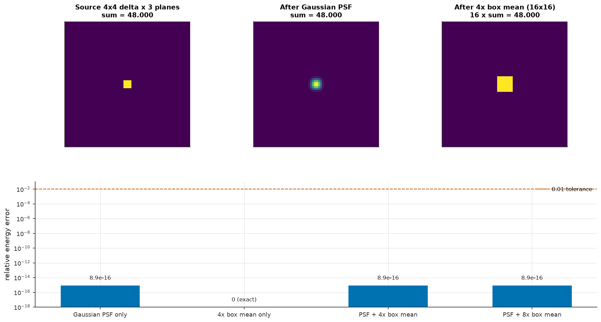
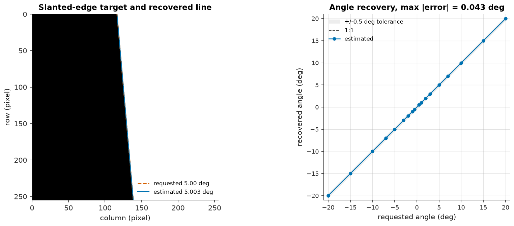

# G1 - Scene and optics validation

**Status: PASS**

G1 closes Phase 1 by checking that the scene, illuminant, and optics
layers are physically consistent before any sensor model consumes them.
It covers the photometric scale of a synthetic scene, the analytic
behaviour of the PSF models, energy conservation through propagation
and 4x pixel integration, the slanted-edge geometric convention, the
external spectral-cube contract, and the reference-lens geometry that
converts cycles/pixel into cycles/degree. No sensor QE/CFA, noise, ADC,
or RAW behaviour is exercised here; those belong to G2.

The numbers apply only to the source tree that generated them. Re-run
`benchmarks/g1_scene_optics.py` after any change to the scene or optics
layers; a stale report is not gate evidence.

## Environment and reproduction

| Item | Value |
|---|---|
| Python | `3.11.8` |
| camsim | `0.1.0.dev0` |
| NumPy | `2.4.6` |
| SciPy | `1.17.1` |
| colour-science | `0.4.7` |
| Platform | `Darwin` |
| Command | `uv run python benchmarks/g1_scene_optics.py` |

## Verdict summary

| Check | Measured | Tolerance | Result |
|---|---|---|---|
| Photometric normalization | max relative error 3.64e-16 | < 0.001 | PASS |
| Gaussian PSF MTF50 | 0.187391 cycles/pixel | within 0.01 of 0.1874 | PASS |
| Airy first zero, reference lens | 1.07810 px | within 1e-3 of 1.078 px; closed form within 1e-12 | PASS |
| PSF + 4x box energy | max relative error 8.88e-16 | < 0.01 | PASS |
| Slanted-edge angle | max |error| 0.0426 deg | < 0.5 deg | PASS |
| Spectral cube contract | 7/7 checks behaved as required | all | PASS |
| Reference lens | 83.677 deg, 99.733 px/deg | 84 +/- 1 deg; 99.73 +/- 0.1 % | PASS |

## 1. Photometric normalization

The scene's absolute scale is a target illuminance. With wavelengths in
nanometres and a per-nanometre spectral irradiance density in W/m^2/nm,

```text
E_scene(lambda) = lux * S(lambda) / (K_M * integral S(lambda) V(lambda) dlambda)
K_M = 683 lm/W
683 * integral E_scene(lambda) V(lambda) dlambda = lux
```

The wavelength axis and the density share the nanometre unit. Converting
the axis to metres without also converting the density from per-nm to
per-metre would make the measured illuminance 1e9 times too small; the
implementation and the tests integrate over `e.wavelengths_nm.nm` with no
such factor. `V(lambda)` is the CIE 1924 photopic luminous efficiency
function and `S(lambda)` is the relative illuminant SPD.

| Requested lux | D65 measured | 3000 K measured | 4000 K measured | Max rel. error |
|---:|---:|---:|---:|---:|
| 0 | 0 | 0 | 0 | 0 |
| 1 | 1 | 1 | 1 | 2.22e-16 |
| 10 | 10 | 10 | 10 | 1.78e-16 |
| 100 | 100 | 100 | 100 | 2.84e-16 |
| 1000 | 1000 | 1000 | 1000 | 2.27e-16 |
| 10000 | 10000 | 10000 | 10000 | 3.64e-16 |
| 100000 | 100000 | 100000 | 100000 | 1.46e-16 |

Tolerance: 0.001 relative. Observed maximum: 3.64e-16. Zero lux is included as a valid
dark scene and returns exactly zero irradiance.


## 2. Analytic PSF MTF and Airy first zero

A sampled Gaussian of `sigma = 1` pixel has the continuous MTF
`exp(-2 pi^2 sigma^2 f^2)`, so its MTF50 is
`sqrt(ln 2 / (2 pi^2)) = 0.187391` cycles/pixel.
The discrete kernel is normalized to unit sum before its MTF is evaluated.

| Quantity | Measured | Reference | Absolute difference |
|---|---:|---:|---:|
| Gaussian kernel sum | 1.000000000000 | 1 | 0.00e+00 |
| Gaussian MTF50 | 0.187391215 | 0.187390625 | 5.90e-07 |
| Airy kernel sum | 1.000000000000 | 1 | 0.00e+00 |
| Airy first zero (exact J1) | 1.07810 px | 1.07810 px | 0 |
| Airy first zero (1.22 convention) | 1.07839 px | 1.07810 px | 2.92e-04 px |
| Airy kernel vs closed form | 0.00e+00 max abs | 0 | 0.00e+00 |

The Airy profile is `(2 J1(x) / x)^2` with
`x = pi r / (lambda N / pitch)`. For the reference lens, the Airy scale
is `lambda N / pitch = 0.883929` px and the exact J1
zero puts the first dark ring at 1.07810 px.
At f/1.8 that ring lies between pixel centres (spacing 1 px), so the
kernel is validated against the closed-form samples; the resolved-ring
check at f/8 lives in `tests/test_psf.py`.

Tolerance: Gaussian MTF50 within 0.01 cycles/pixel of
0.1874; Airy first zero within 1e-3 px of 1.078 px; sampled Airy kernel
within 1e-12 of the closed form.


## 3. Energy conservation through PSF and 4x downsampling

Convolution cannot create or destroy light, and the block mean models
pixel-aperture integration, so the total energy must survive both. The
input is a 4x4 delta in three spectral planes (total 48.0). A block mean
reduces the raw sum by `factor**2`, so the table compares each stage
after multiplying by that factor; the tolerance is on the compensated
total.

| Stage | Compensated sum | Reference sum | Relative error |
|---|---:|---:|---:|
| Gaussian PSF only | 48.000000 | 48.000000 | 8.88e-16 |
| 4x box mean only | 48.000000 | 48.000000 | 0 |
| PSF + 4x box mean | 48.000000 | 48.000000 | 8.88e-16 |
| PSF + 8x box mean | 48.000000 | 48.000000 | 8.88e-16 |

The constant-field check returns a block-mean value of
1.000000000000 for a field of ones (relative
error 0), confirming
that the reducer averages rather than sums.

Tolerance: 0.01 relative. Observed maximum: 8.88e-16.



## 4. Slanted-edge angle recovery

The target rasterizes a binary reflectance step through the image centre
at a requested tilt. `estimate_edge_angle` takes the horizontal Sobel
gradient, keeps the columns near each row's gradient peak, forms an
energy-weighted centroid per row, and fits a weighted line whose slope
is `tan(theta)`. Positive angles move the edge rightwards as the row
index increases.

| Requested angle (deg) | Recovered angle (deg) | Error (deg) |
|---:|---:|---:|
| -20.00 | -19.9852 | +0.0148 |
| -15.00 | -14.9972 | +0.0028 |
| -10.00 | -9.9906 | +0.0094 |
| -7.00 | -6.9899 | +0.0101 |
| -5.00 | -5.0028 | -0.0028 |
| -3.00 | -2.9873 | +0.0127 |
| -2.00 | -1.9872 | +0.0128 |
| -1.00 | -1.0102 | -0.0102 |
| -0.50 | -0.5426 | -0.0426 |
| +0.50 | +0.5426 | +0.0426 |
| +1.00 | +1.0102 | +0.0102 |
| +2.00 | +1.9872 | -0.0128 |
| +3.00 | +2.9873 | -0.0127 |
| +5.00 | +5.0028 | +0.0028 |
| +7.00 | +6.9899 | -0.0101 |
| +10.00 | +9.9906 | -0.0094 |
| +15.00 | +14.9972 | -0.0028 |
| +20.00 | +19.9852 | -0.0148 |

Tolerance: 0.5 deg absolute. Observed maximum: 0.0426 deg. This check validates the geometric
convention shared by the target and estimator. A full ISO 12233-style
e-SFR measurement on rendered, blurred, noisy edges belongs to the G4
metrics gate and is not claimed here.



## 5. Spectral cube and unit contract

The external `SpectralIrradiance` boundary must accept a cube whose
wavelength grid matches its data and reject every mismatch rather than
silently returning a mis-coloured capture. Explicit resampling helpers
must conserve the represented energy and update pixel-pitch metadata.

| Check | Expected | Observed | Result |
|---|---|---|---|
| Matching grid accepted | shape, unit, and pitch preserved | (8, 8, 7), W/m^2/nm, 4.48 um | PASS |
| Data/grid length mismatch | ValueError | ValueError: SpectralIrradiance data has 8 wavelength samples but the wavelength grid has 7 | PASS |
| Unsupported unit | ValueError | ValueError: unit must be one of ('W/m^2/nm', 'photons/s/m^2/nm'); got 'W/m^2/um' | PASS |
| Negative irradiance | ValueError | ValueError: SpectralIrradiance data must be non-negative | PASS |
| Uncovered wavelength range | ValueError | ValueError: target wavelength range [350, 700] nm is not covered by the input range [400, 700] nm; pass allow_zero_fill=True to zero-fill uncovered regions | PASS |
| Spatial box resampling | energy preserved; pitch x4 | relative error 0.00e+00; pitch 17.92 um | PASS |
| Wavelength integration | same-domain integral preserved | relative error 0.00e+00 | PASS |

The spatial box resample reports a relative energy error of
0 and a pitch of
17.92 um (4.48 um x 4). The wavelength
integration error over the same 400-700 nm domain is
0. Sensor-side
pitch and shape compatibility is enforced when a sensor consumes a
cube, which is part of G2.

## 6. Reference lens geometry

| Quantity | Measured | Tolerance | Result |
|---|---:|---|---|
| Diagonal field of view | 83.6770 deg | 84 +/- 1 deg | PASS |
| Angular sampling | 99.7331 px/deg | 99.73 +/- 0.1% | PASS |
| Gaussian MTF50 at the reference scale | 18.6891 cycles/deg | informational | - |

A pixel of pitch `p` subtends `atan(p / f)` radians, so
`pixels_per_degree = 1 / degrees(atan(p / f))`; equivalently
`pi / (180 * atan(p / f))`. At 1.12 um and 6.4 mm this is 99.7331
px/deg, which turns the unit-sigma Gaussian's 0.187391 cycles/pixel into
18.689 cycles/degree.

## Assumptions and limitations

- **Scope.** G1 covers `camsim.scene` and `camsim.optics` only. Sensor QE,
  CFA, shot/read/dark noise, ADC clipping, and the RAW frame contract are
  G2 evidence and are not validated here.
- **Optics is a supporting model, not a calibrated lens.** The Gaussian is
  an aberration/defocus approximation, the Airy kernel is an ideal
  circular pupil, and the box is the pixel aperture. There is no
  wavefront aberration, pupil apodization, wavelength-dependent PSF,
  polychromatic diffraction, field-dependent blur, or measured lens
  prescription, so these numbers demonstrate physical consistency rather
  than a specific lens's performance.
- **ISO 12233-style e-SFR is deferred.** The edge check validates only the
  target/estimator angle convention; edge-spread-function MTF on rendered,
  blurred, noisy images belongs to the G4 metrics gate.
- **D65 endpoint extrapolation.** `colour-science` tabulates D65 from 300
  to 780 nm. camsim interpolates it onto the 360-830 nm grid and holds the
  780 nm value constant from 780 to 830 nm. V(lambda) is about 1.5e-5 at
  780 nm and 4.5e-7 at 830 nm, so this tail changes the photometric
  normalization by far less than the 1e-3 tolerance; the flat red tail is
  visible in spectral plots.
- **Photometric band.** The luminous integral covers the tabulated
  360-830 nm band. `photopic_luminous_efficiency` returns zero outside the
  CIE 1924 table by contract, so missing ultraviolet and infrared bands
  contribute no luminous flux. Radiometric energy outside the band is
  intentionally not modelled.
- **Reference lens.** The configuration uses a scalar transmittance of
  0.9, no vignetting, a 6.4 mm focal length, an
  11.46 mm diagonal, and a 1.12 um pitch. The
  simulated 83.68 deg field rounds to the documented
  approximately 84 deg, not an exact 84.0 deg.
- **Energy budget.** Symmetric kernels with half-sample-reflection borders
  conserve energy to floating-point round-off. An asymmetric kernel wraps
  some mass at the frame border and is guaranteed only within the
  documented 1 % energy budget.
- **Spectral resampling.** Wavelength resampling is overlap-weighted
  piecewise-constant integration and refuses to extrapolate outside the
  measured range. Spatial resampling requires an exact block division, so
  no partial block represents a fractional pixel area.
- **Determinism.** The Markdown report and the numerical results are
  deterministic for a fixed environment. PNG metadata is fixed, but
  Matplotlib and font builds can change rendered bytes across platforms;
  cross-platform comparisons should use the reported numbers and a
  pixel tolerance rather than byte equality.

## Reproduction

```bash
uv run python benchmarks/g1_scene_optics.py
uv run pytest tests/test_validation_g1.py -v
uv run pytest tests/test_validation_g1.py tests/test_units.py tests/test_spectral.py \
  tests/test_lens.py tests/test_psf.py tests/test_targets.py tests/test_propagation.py tests/test_glyphs.py -v
uv run pytest -q
uv run ruff check . && uv run mypy src
```

The four figures live at `results/figures/g1_lux_normalization.png`,
`g1_psf_mtf.png`, `g1_energy_conservation.png`, and `g1_edge_angle.png`.
