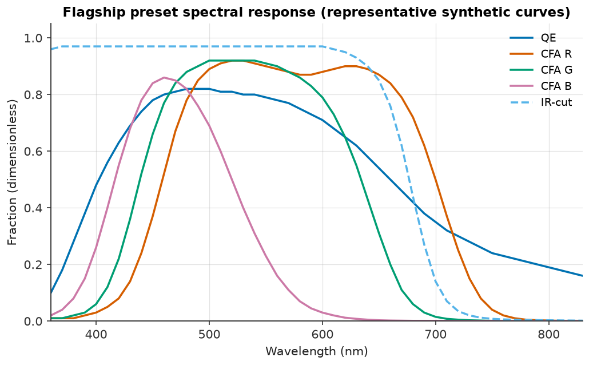
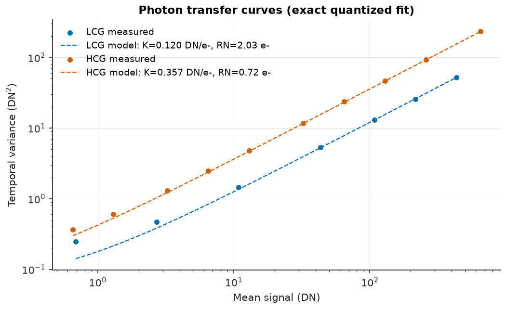
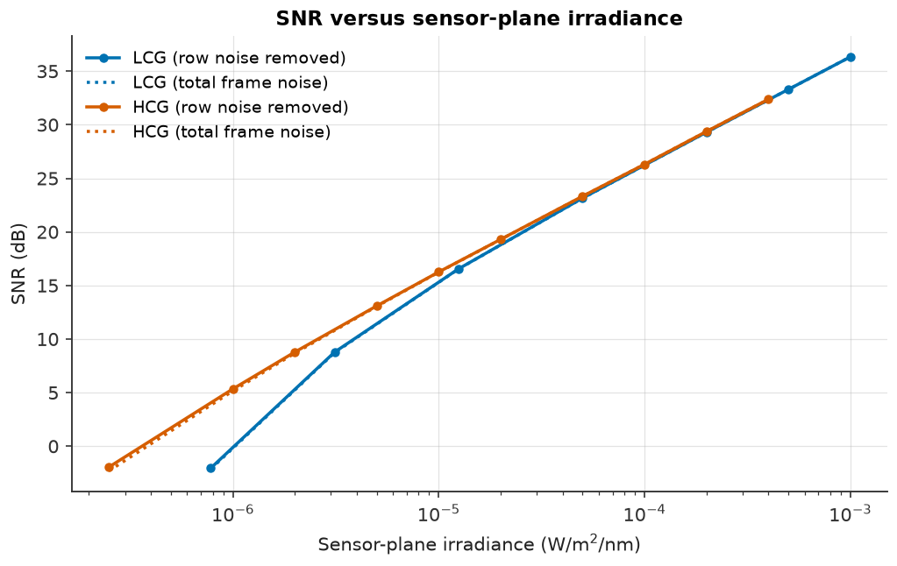
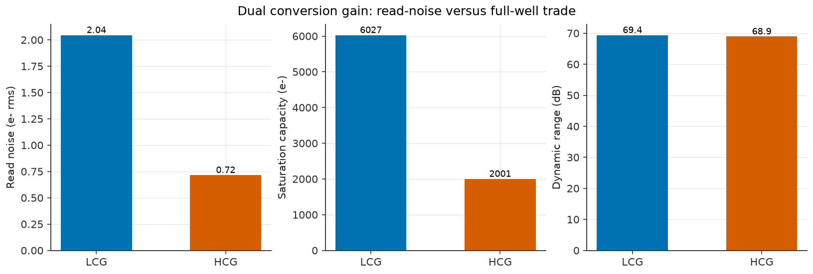
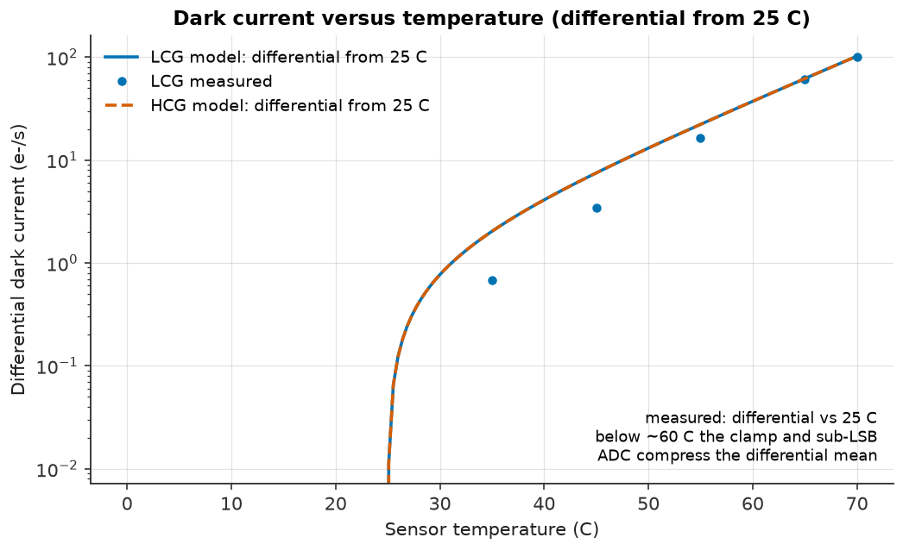
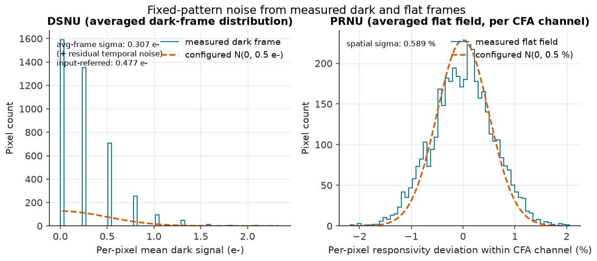

# G2 - Sensor model and EMVA characterization

**Status: PASS**

G2 closes Phase 2 by checking that the sensor model converts spectral
irradiance into electrons and RAW codes with the configured physics, and that
an EMVA 1288-style characterization recovers the preset's datasheet-style
parameters within stated tolerances. It covers the CFA/spectral projection,
shot and fixed-pattern noise, full well, dual conversion gain, ADC scale and
black level, dark current, and the characterization fit. It does not exercise
demosaicing, white balance, colour correction, or any other ISP stage; those
belong to G3.

The numbers apply only to the preset and source tree that generated them.
Re-run `examples/04_emva_characterization.py` after any change to the sensor
model, the flagship preset, or the spectral CSVs; a stale report is not gate
evidence.

This is a **simulated, EMVA 1288-style characterization**. It is not a
certified measurement of a physical sensor. The flagship preset is a
representative engineering design point, not a claim about a specific
commercial part.

## Environment and reproduction

| Item | Value |
|---|---|
| Python | `3.11.8` |
| camsim | `0.1.0.dev0` |
| NumPy | `2.4.6` |
| SciPy | `1.17.1` |
| Platform | `Darwin` |
| Preset | `src/camsim/config/presets/sensors/flagship_phone_50mp.json` |
| Preset hash | `e6b3f6a5162d60b805cfba2651aa5e9c705d86bf84a534ba8dcde4a09f42d4a2` |
| Artifact generator | `uv run python examples/04_emva_characterization.py` |
| Machine-readable results | `results/reports/g2_sensor_results.json` |
| Gate tests | `uv run pytest tests/test_sensor.py tests/test_noise.py tests/test_defects.py tests/test_gain.py tests/test_adc.py tests/test_characterization.py tests/test_preset_validation.py -v` |

The characterization uses 32 frames per level, a 10 ms exposure, and the G2 LCG
sweep from the task brief. HCG uses a shorter low-to-saturation sweep because
its highlights begin to clip near 4.6e-4 W/m²/nm. Every frame is seeded with
`base_seed + global_frame_index`; the fixed-pattern maps come from the preset's
defect seed. The dark-current sweep uses 16 dark frames per temperature at a
0.1 s exposure with `base_seed=21`. Runs are deterministic within one software
environment.

## Verdict summary

All 16 checks pass. Tolerances are the G2 design gates: read noise within 5 %,
DSNU/PRNU and saturation within 10 %, linearity residual below 0.05, dynamic
range between 30 and 90 dB, the PTC slope within 2 % of the configured ADC
system gain, and dark current within 5 % of the differential doubling model at
65 C and 70 C.

| Check | Measured | Tolerance | Result |
|---|---:|---|---|
| LCG read noise | 2.0449 e- rms | 2.0 +/- 5 % | PASS |
| LCG DSNU | 0.4995 e- | 0.5 +/- 10 % | PASS |
| LCG PRNU | 0.4959 % | 0.5 +/- 10 % | PASS |
| LCG saturation capacity | 6026.6 e- | 6000 +/- 10 % | PASS |
| LCG linearity residual | 1.79e-5 | < 0.05 | PASS |
| LCG dynamic range | 69.39 dB | 30-90 dB | PASS |
| LCG system gain relative error | -0.476 % | < 2 % | PASS |
| HCG read noise | 0.7153 e- rms | 0.7 +/- 5 % | PASS |
| HCG DSNU | 0.4989 e- | 0.5 +/- 10 % | PASS |
| HCG PRNU | 0.5014 % | 0.5 +/- 10 % | PASS |
| HCG saturation capacity | 2000.9 e- | 2000 +/- 10 % | PASS |
| HCG linearity residual | 6.81e-5 | < 0.05 | PASS |
| HCG dynamic range | 68.94 dB | 30-90 dB | PASS |
| HCG system gain relative error | -0.073 % | < 2 % | PASS |
| Dark current at 65 C (differential) | 60.98 e-/s | 61.80 +/- 5 % | PASS |
| Dark current at 70 C (differential) | 100.39 e-/s | 102.17 +/- 5 % | PASS |

## 1. Spectral response and packaging

The preset's QE, CFA, and IR-cut curves are bundled package resources under
`src/camsim/data/spectra/` and resolved through `camsim.data.data_path`, so a
sensor constructs from an installed wheel without the source checkout or a
particular working directory. They are original synthetic engineering
estimates, not digitized vendor plots; the provenance is repeated in each CSV's
comment header, in the preset's `provenance.assumptions`, and in
`THIRD_PARTY.md`.

The sensor multiplies the three dimensionless curves before integration:
`QE(lambda) * T_IR(lambda) * T_CFA,c(lambda)`. Each CFA channel therefore has a
different integrated response, which is what produces the RGGB mosaic balance.
A percent-valued curve is rejected by the CSV reader as a units error; adding
the curves instead of multiplying them would count photons more than once.

The packaging contract is covered by
`tests/test_package.py::test_spectral_csvs_ship_inside_the_package`,
`test_preset_uses_package_relative_spectral_paths`, and
`test_sensor_constructs_from_package_data_in_a_subprocess`. A built wheel was
also inspected for the three CSVs; see the ancillary packaging check in
section 7.

## 2. Photon transfer curve, gain, and read noise

For a pixel with mean signal `mu_DN` and temporal variance `sigma_DN**2` in
black-level-corrected DN, Poisson shot noise plus input-referred read noise
gives `sigma_DN**2 = K * mu_DN + sigma_read_DN**2`. The fit is against the exact
quantized forward model, `round(K * (Poisson(mu) + N(0, sigma_read)))` with the
charge clipped at zero, because the LCG read noise is only about 0.24 DN and
the asymptotic `1/12 DN**2` quantization correction biases both parameters.
Frames are row-demeaned per CFA plane to remove common-mode row noise, then
scaled by `n/(n-1)` to restore the independent degrees of freedom.

| Quantity | LCG | HCG |
|---|---:|---:|
| Fitted system gain K | 0.11930 DN/e- | 0.35936 DN/e- |
| Nominal ADC system gain | 0.119875 DN/e- | 0.359625 DN/e- |
| Relative gain error | -0.476 % | -0.073 % |
| Read noise | 2.0449 e- rms | 0.7153 e- rms |
| Configured read noise | 2.0 e- rms | 0.7 e- rms |
| Saturation capacity | 6026.6 e- | 2000.9 e- |
| Configured full well | 6000 e- | 2000 e- |
| PTC channel-level points | 18 | 26 |

The measured saturation cross-check is 1.0044x the configured full well for LCG
and 1.0005x for HCG, consistent with the clipped flat field landing on the
full-well-limited code. Both modes are full-well limited at unity analog gain:
600000 uV at full well is below the 800000 uV ADC full scale.

## 3. SNR, linearity, and dynamic range

SNR is `20 log10(signal_e / noise_e)`. The solid curves use row-demeaned
pixel-temporal noise; the dotted curves use total frame noise, which includes
common-mode row noise. The two nearly coincide in this preset because row noise
is 0.5 e- rms against hundreds of electrons of shot noise at the plotted
levels.

Linearity is the maximum relative deviation from a straight-line fit over
unsaturated levels between 5 % and 95 % of the saturation code. Both modes are
linear to better than 0.0001, far inside the 0.05 gate. Dynamic range is
`20 log10(saturation_capacity / read_noise)`: 69.39 dB for LCG and 68.94 dB for
HCG. The small HCG advantage in read noise is almost exactly offset by its
smaller full well, which is the expected dual-conversion-gain trade.

## 4. LCG versus HCG

| Metric | LCG | HCG | Trade |
|---|---:|---:|---|
| Read noise | 2.0449 e- rms | 0.7153 e- rms | 2.9x lower in HCG |
| Saturation capacity | 6026.6 e- | 2000.9 e- | 3.0x higher in LCG |
| Dynamic range | 69.39 dB | 68.94 dB | within 0.5 dB |

The full-well ratio and read-noise ratio are both about three, so the dynamic
range is nearly unchanged: high conversion gain buys low-light SNR at the cost
of highlight headroom, not free dynamic range. The characterization locks one
mode per report because a PTC mixing two conversion gains has no single slope.

## 5. Dark current versus temperature

Dark current follows `D(T) = D_ref * 2**((T - T_ref) / T_double)` with
`D_ref = 1.2 e-/s` at 25 C and a 7 K doubling interval. The measured points are
differential dark-frame rates relative to 25 C: the sensor clamps charge at
zero after read noise, so a dark frame has a positive mean code even without
dark current, and subtracting the 25 C mean removes that constant
rectification offset. The model column is therefore the same differential
quantity, `D(T) - D(25 C) = D(T) - 1.2 e-/s`, not the absolute rate `D(T)`.
Comparing a differential measurement with an absolute model would inflate the
apparent error by the reference term.

| Temperature | Measured | Differential model | Difference |
|---:|---:|---:|---:|
| 35 C | 0.674 e-/s | 2.030 e-/s | -66.8 % |
| 45 C | 3.407 e-/s | 7.495 e-/s | -54.5 % |
| 55 C | 16.333 e-/s | 22.205 e-/s | -26.4 % |
| 65 C | 60.976 e-/s | 61.802 e-/s | -1.3 % |
| 70 C | 100.390 e-/s | 102.165 e-/s | -1.7 % |

Only the 65 C and 70 C points are gate criteria, with a 5 % tolerance. Below
about 60 C the differential signal per 0.1 s exposure is well under one ADC
code (LCG resolves about 8.4 e- per DN), and the zero-charge clamp plus
phase-dependent quantization compress the mean, so the differential estimate
is biased low. Those points are shown for the model shape, not as a pass/fail
claim. At 65 C and 70 C the differential dark signal is about 0.74 DN and
1.22 DN; still around one code, but averaging 16 frames over roughly 4,000
valid pixels resolves the mean well enough that the measured rates agree with
the differential doubling model within 1.3 % and 1.7 %.

## 6. DSNU and PRNU

DSNU is the dark-signal non-uniformity: the per-pixel dark offset in electrons.
PRNU is the photo-response non-uniformity: the per-pixel relative responsivity
deviation, reported in percent because datasheets quote it that way (0.005
fraction = 0.5 %). Both are fixed for the life of a part and are calibrated out
with dark and flat fields respectively.

The report values come from the characterization:

- DSNU is measured from dark frames and inverted through the exact pre-clamp
  model `Poisson(max(0, d)) + N(0, sigma_read)` with the zero-charge clip and
  integer ADC rounding. The raw post-clamp spread is only 0.146 e- in LCG and
  0.264 e- in HCG because the dark offset is sub-LSB; the input-referred values
  recover the configured 0.5 e- within 0.1 % (LCG) and 0.22 % (HCG).
- PRNU is measured from the unsaturated flat field nearest 70 % of saturation,
  corrected for temporal variance and DSNU, then normalised by the mean. The
  measured 0.4959 % (LCG) and 0.5014 % (HCG) recover the configured 0.5 %.

The figure shows the measured per-pixel distributions. The dark histogram is
the averaged dark frame: it contains the fixed pattern plus residual temporal
noise of the 32-frame mean (raw spread 0.308 e-), which is why it is not the
input-referred 0.500 e- value. The PRNU histogram normalises each CFA channel
separately; normalising the RGGB mosaic as one population would report the
colour pattern itself as roughly 25 % PRNU, a classic analysis error.

### Eight-frame DSNU waiver

The G2 evidence uses 32 frames per level. A separate eight-frame LCG robustness
sweep in `tests/test_characterization.py` uses the same high-level irradiance
list as this report and is allowed a documented 20 % DSNU envelope instead of
10 %: at eight frames the averaged dark frame is too noisy for the tighter
gate. That sweep is a robustness check, not G2 evidence; the 32-frame result
above is the gate.

## 7. Ancillary contracts closed in this task

- **Spatial crosstalk.** `SensorConfig.spatial_crosstalk` accepts an optional
  normalized 2-D kernel. The sensor applies it to each CFA channel plane in the
  electron domain after spectral crosstalk and before read noise. The schema
  rejects ragged, negative, non-finite, or non-unit-sum kernels; the wiring test
  shows an interior impulse is redistributed by a 3x3 kernel with total charge
  preserved. The flagship preset leaves it disabled (`null`), so it does not
  change these G2 numbers.
- **Data packaging.** The QE/CFA/IR-cut CSVs moved from the repository root into
  `src/camsim/data/spectra/` and are resolved with `importlib.resources`. The
  preset paths are package-relative (`spectra/*.csv`), and a subprocess test
  constructs a sensor from the package layout with the working directory
  outside the repository. `uv build` was run and the wheel listing was checked
  for all three CSVs.
- **Determinism.** The existing per-call-seed and fixed-pattern-map tests remain
  in the gate; repeated runs of the example produce the same JSON values and
  the same figure set.

## Assumptions and limitations

- **Simulated, not certified.** This is an EMVA 1288-style measurement of a
  simulated sensor, not a certified measurement of a physical camera.
- **Representative preset.** No value is a measured property of a specific
  commercial part. The spectral curves are synthetic estimates, and the noise,
  defect, and dark-current parameters are engineering assumptions.
- **Uniform illumination.** The flat field is spatially uniform; the model does
  not include lens shading, illumination ripple, or camera shading.
- **One mode per PTC.** LCG and HCG are characterized separately; `auto` is
  resolved once to a single mode because a mixed PTC has no single slope.
- **Constant temperature.** Each characterization holds temperature fixed.
  Dark current versus temperature is measured separately as described above.
- **Ideal ADC.** The ADC is linear with a fixed black level; no missing codes,
  column gain, or row-wise offset calibration is modelled beyond the explicit
  row-noise term.
- **Sub-LSB limitations.** LCG read noise is about 0.24 DN and HCG about
  0.26 DN, so the exact quantized fit is used instead of the asymptotic
  quantization correction. Residual row-noise/quantization coupling leaves a
  few percent uncertainty in HCG read noise at this operating point; the
  32-frame measurement is inside the 5 % gate at the documented seeds.
- **DSNU inversion range.** The pre-clamp inversion is valid to 20 e-; a larger
  observed dark fixed pattern raises rather than silently clamping.
- **Dark-current differential.** Low-temperature dark-current points are
  compression-limited and are excluded from the gate; only 65 C and 70 C are
  compared with the differential doubling model `D(T) - D(25 C)` under the
  5 % tolerance.
- **Determinism scope.** Determinism is promised within one environment; a
  different NumPy/SciPy build can change floating-point reduction order and
  therefore the last digits, which is why the report compares tolerances rather
  than bit patterns.

## Figure index

| Figure | Path |
|---|---|
| QE, CFA, IR-cut | `results/figures/g2_qe_cfa_ir_cut.png` |
| Photon transfer curves | `results/figures/g2_ptc.png` |
| SNR versus irradiance | `results/figures/g2_snr_vs_irradiance.png` |
| Dark current versus temperature | `results/figures/g2_dark_current_vs_temperature.png` |
| LCG/HCG comparison | `results/figures/g2_lcg_hcg_comparison.png` |
| DSNU/PRNU histograms | `results/figures/g2_dsnu_prnu_histograms.png` |
