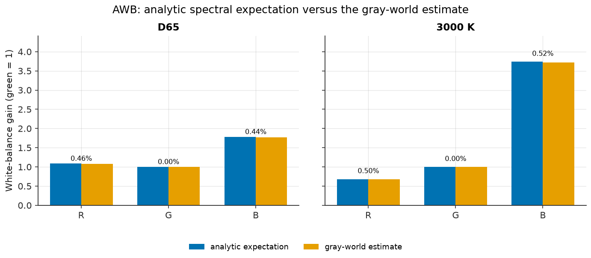

# G3 - ISP validation

**Status: PASS**

G3 closes Phase 3 by running the complete image-signal-processing chain
from a spectral ColorChecker scene through the sensor to a rendered
display image, then measuring colour accuracy, white balance, demosaic
agreement, tone, stage-trace consistency, linearity, lens shading,
denoising, sharpening, and the RCCC baseline. The measurements are
produced by `camsim.characterization.measure_g3`; this report and the
machine-readable JSON are generated by the same full example run, so a
stale report is detectable.

**All measured G3 checks pass.** The design ColorChecker gate is mean
ΔE2000 < 2.0 under D65 and < 4.0 under 3000 K after an in-sample 3x3
CCM. The measured means are 0.919 and 3.834, below the limits. The shipped
sensor preset uses synthetic conventional Bayer bands (blue ~448 nm,
green ~542 nm, red ~610 nm) with moderate out-of-band leakage; the
original broad, nearly collinear CFA curves were replaced after the G3
gate showed that no 3x3 matrix could colour-correct them. The
Luther-condition residual is now 12.6 %, versus 45.6 % for
the superseded curves. The CCM is still fitted and evaluated in-sample;
that is stated under limitations. The ΔE thresholds were not changed.

All evidence is simulated. It is not a certified ISO 12233 or EMVA 1288
measurement, and the flagship preset is a representative engineering
design point rather than a measurement of one commercial part.

## Environment and reproduction

| Item | Value |
|---|---|
| Python | `3.11.8` |
| camsim | `0.1.0.dev0` |
| NumPy | `2.4.6` |
| SciPy | `1.17.1` |
| colour-science | `0.4.7` |
| colour-demosaicing | `0.2.7` |
| Platform | `Darwin` |
| Sensor preset | `src/camsim/config/presets/sensors/flagship_phone_50mp.json` |
| ISP preset | `src/camsim/config/presets/isp/default.json` |
| Sensor config hash | `dc383811bd9307f5d864d917da8fc7ac918e2983c802dc900ad56463d9b3b591` |
| ISP config hash (base preset) | `790c97d8f00b352fe31f2ffd26fd46e89c47caf308622db51d397308ed49a627` |
| Calibration ISP hash (D65) | `e7790aa9efd05c51a43d4ec2cd7bc799572f1ff5e2794e0af9acfa97a05e2043` |
| Calibration ISP hash (3000 K) | `ced5532a47a6e26ad151e15bf55ea72f01748bb525f67dd2b0ff96977ff12e81` |
| Artifact generator | `uv run python examples/02_isp_stage_gallery.py` |
| Machine-readable results | `results/reports/g3_isp_results.json` |
| Gate tests | `uv run pytest tests/test_example_02.py -v` |
| Quick smoke | `CAMSIM_FIG_DIR=/tmp/g3_quick_figures uv run python examples/02_isp_stage_gallery.py --quick --report-dir /tmp/g3_quick_reports` (not gate evidence; suffixed figures) |

The full run uses a 128 x 96 ColorChecker at 300 lux with 2x
oversampling, the shipped flagship sensor at LCG, and the D65 and 3000 K
illuminants. The exposure calibration requests 70 % of the ADC white span but is bounded by the preset's 0.100 s ceiling. D65 reaches the preset ceiling at 100.00 ms and achieves 60.8 %; 3000K uses 91.13 ms and achieves 68.7 %.

Seeds: probe 100, scene 101, flat 111, LSC 61, denoise 62. Each illuminant reuses the scene and flat seeds with its own spectrum; LSC and denoise use explicit numpy Generator seeds; sharpen and the star/RCCC targets are deterministic without RNG.

## ISP chain and linear-space invariant

The enforced order is `DPC -> BLC -> LSC -> AWB -> demosaic -> CCM ->
denoise -> sharpen -> tone -> output`. DPC, BLC, LSC, AWB, demosaicing,
the CCM, denoise, and sharpen operate in linear float32 light. BLC
subtracts the 64 DN pedestal and divides by the 959 DN white span, so
ADC saturation maps to 1.0. The tone stage applies the exposure trim in
linear light, converts to Display P3 when requested, clamps to the
display range, and applies the sRGB OETF; it is the only non-linear
step. The linear pre-tone scaling check verifies this invariant directly.

## Measurement methodology

**Spectral scene to RAW.** `camsim.scene.render` multiplies ColorChecker
reflectance by the photometrically normalised illuminant and the lens
term, then boxes the oversampled target down to the sensor grid. The
sensor integrates QE x IR-cut x CFA x photon flux, adds shot, read, and
fixed-pattern noise, applies conversion and analog gain, and quantises
to 10-bit codes with a 64 DN pedestal. Every exposure uses a fixed seed.

**White balance and camera RGB.** The analytic per-channel response to a
perfect diffuser under each illuminant gives green-normalised manual AWB
gains. Using the perfect diffuser, rather than the chart's white patch,
is what makes a row-sum CCM neutral-preserving: the reference Lab scale
is defined by the perfect diffuser. The pipeline then runs with the CCM
disabled and the trace enabled, and the 24 patch means are taken from
the demosaiced, white-balanced linear RGB buffer.

**Target linear sRGB.** The reference Lab is converted back to XYZ with
the scene illuminant's white point, adapted to CIE D65 with the Bradford
transform, and converted to **linear** sRGB with
`colour.XYZ_to_RGB(..., apply_cctf_encoding=False)`. The perfect-diffuser
white therefore maps to (1, 1, 1); the camera RGB is divided by the
measured perfect-diffuser level before fitting, and the tone stage's
exposure compensation restores the absolute scale.

**CCM and ΔE2000.** One ridge-regularised 3x3 matrix per illuminant is
fitted with `camsim.isp.ccm.fit_ccm(..., ridge=1e-4, row_sum=True)` on
the same 24 patches used for evaluation (in-sample calibration-scene
validation). The rendered sRGB display is decoded with the sRGB EOTF to
XYZ D65 and CIE Lab, and CIEDE2000 is computed per patch against the
reference Lab. In-sample fitting measures whether the ISP can represent
the calibration scene at all; it does not measure generalisation to a
held-out chart or a different illuminant.

**AWB, demosaic, tone, and trace.** The gray-world estimator runs on a
50 % neutral flat field under each illuminant; expected gains come from
the analytic spectral response, and a second check injects a known
per-CFA cast (R x1.6, G x1.0, B x0.7) and requires the estimator to
invert it. Bilinear and MHC are compared with `colour-demosaicing` on a
synthetic Siemens-star RGB mosaic with independent R, G, and B
structure. The sRGB OETF is compared with `colour.cctf_encoding`. The
stage trace is validated by applying the tone configuration to the last
linear trace stage and comparing both the display array and the
unclipped `linear_rgb` buffer at +0.5 EV in Display P3.

## Verdict summary

| Check | Measured | Tolerance | Result |
|---|---|---|---|
| ColorChecker mean deltaE2000 (D65) | 0.918931 | < 2 | PASS |
| ColorChecker mean deltaE2000 (3000 K) | 3.83422 | < 4 | PASS |
| AWB gain relative error, R (D65) | 0.00464816 | < 0.05 | PASS |
| AWB gain relative error, B (D65) | 0.00443304 | < 0.05 | PASS |
| AWB gain relative error, R (3000 K) | 0.00496836 | < 0.05 | PASS |
| AWB gain relative error, B (3000 K) | 0.00517455 | < 0.05 | PASS |
| AWB injected-cast recovery (max relative error) | 0.0066654 | < 0.05 | PASS |
| Bilinear demosaic vs colour-demosaicing (max abs) | 1.192e-07 | < 1e-05 | PASS |
| MHC demosaic vs colour-demosaicing (max abs) | 2.161e-07 | < 0.0001 | PASS |
| sRGB OETF vs colour.cctf_encoding (max abs) | 2.977e-08 | < 1e-07 | PASS |
| Stage trace tone reproduction (max abs) | 0 | < 1e-06 | PASS |
| Stage trace linear_rgb reproduction (Display P3, max abs) | 0 | < 1e-06 | PASS |
| Linear pre-tone scaling invariance (max relative error) | 0 | < 1e-05 | PASS |
| LSC flat-field residual after correction | 0.00618314 | < 0.02 | PASS |
| Denoise SNR gain (dB) | 13.0556 | > 3 | PASS |
| Denoise edge-contrast preservation | 4.333e-05 | < 0.1 | PASS |
| Sharpen edge-contrast gain | 0.587229 | > 0 | PASS |
| Sharpen overshoot | 0.117446 | > 0 | PASS |
| RCCC baseline output channels | 3 | = 3 +/- 0 | PASS |

## 1. End-to-end ColorChecker colour

The fitted matrices (rows sum to one to machine precision) are:

| Illuminant | Row 1 | Row 2 | Row 3 |
|---|---|---|---|
| D65 | +1.827024, -0.732703, -0.094321 | -0.122786, +1.257255, -0.134469 | -0.084741, -0.131298, +1.216038 |
| 3000K | +1.924152, -0.811940, -0.112212 | -0.148279, +1.226613, -0.078335 | -0.205784, -0.225196, +1.430980 |

Per-patch CIEDE2000 between the rendered display and the spectrally
computed reference:

| Patch | D65 deltaE2000 | 3000 K deltaE2000 |
|---|---:|---:|
| dark skin | 0.372 | 1.587 |
| light skin | 1.429 | 0.999 |
| blue sky | 0.545 | 6.031 |
| foliage | 0.541 | 3.442 |
| blue flower | 0.528 | 5.978 |
| bluish green | 1.099 | 3.000 |
| orange | 0.306 | 2.562 |
| purplish blue | 0.740 | 11.077 |
| moderate red | 0.646 | 3.297 |
| purple | 1.086 | 2.668 |
| yellow green | 0.056 | 5.826 |
| orange yellow | 0.732 | 4.531 |
| blue | 0.935 | 13.208 |
| green | 1.500 | 3.146 |
| red | 2.157 | 2.721 |
| yellow | 0.200 | 6.131 |
| magenta | 0.876 | 2.546 |
| cyan | 2.153 | 7.797 |
| white 9.5 (.05 D) | 0.339 | 1.005 |
| neutral 8 (.23 D) | 1.791 | 0.899 |
| neutral 6.5 (.44 D) | 1.627 | 0.970 |
| neutral 5 (.70 D) | 0.535 | 0.720 |
| neutral 3.5 (1.05 D) | 0.519 | 0.739 |
| black 2 (1.5 D) | 1.345 | 1.141 |

The means are 0.919 (D65) and 3.834 (3000 K); both means are below the 2.0 and 4.0 limits. The pre-clip means are
0.919 and 3.834; display clipping is
negligible. The CCM fit RMS residuals are 0.0081 and 0.0064 linear RGB,
and the matrix rows sum to one to machine precision. The fitted
coefficients and per-patch values are recorded in the JSON.

The 3000 K mean is 3.834, 4.14 % below the 4.0 limit (quick smoke: 3.914, 2.16 % below; not gate evidence). The gate is mean-only; per-patch maxima reach 13.208 (blue) and 11.077 (purplish blue).

**CFA rationale.** The preset uses conventional Bayer passbands
centred near 448 nm (blue), 542 nm (green), and 610 nm (red) with
moderate out-of-band leakage and peak transmittance 0.86-0.91
(R 0.905, G 0.903, B 0.864). The Luther-condition relative residual
is 0.126; the CFA projection
condition number is 1.56 and the R/G
correlation is 0.187. The
superseded broad curves left a 45.6 % residual and could not be
colour-corrected by any 3x3 matrix; the conventional bands reduce the
residual and the in-sample CCM meets both ΔE gates. The fit remains
in-sample: it measures calibration-scene representability, not
generalisation to a held-out chart or a different illuminant.


## 2. White balance

Expected gains are the analytic spectral response ratios; measured
gains are the gray-world estimate on a uniform 50 % flat field.

| Illuminant | Channel | Expected gain | Measured gain | Relative error | Result |
|---|---|---:|---:|---:|---|
| D65 | R | 1.085697 | 1.080650 | 0.004648 | PASS |
| D65 | G | 1.000000 | 1.000000 | 0.000000 | PASS |
| D65 | B | 1.781509 | 1.773612 | 0.004433 | PASS |
| 3000K | R | 0.682753 | 0.679361 | 0.004968 | PASS |
| 3000K | G | 1.000000 | 1.000000 | 0.000000 | PASS |
| 3000K | B | 3.738552 | 3.719207 | 0.005175 | PASS |

The injected-cast check (R x1.6, G x1, B x0.7)
recovers the expected gains with a maximum relative error of 0.67 %. All non-green
channels are within the 5 % tolerance.



## 3. Demosaic, tone, trace, and linearity

| Quantity | Value |
|---|---:|
| Bilinear max abs vs colour-demosaicing | 1.192e-07 |
| MHC max abs vs colour-demosaicing | 2.161e-07 |
| sRGB OETF max abs vs colour-science | 2.977e-08 |
| Trace display reproduction max abs | 0.000e+00 |
| Trace linear_rgb reproduction max abs | 0.000e+00 |
| Linear pre-tone scaling max relative error | 0.000e+00 |

The trace stage order in the Display P3 validation is `dpc -> blc -> awb -> demosaic -> ccm -> tone -> output`. The tone and linear-buffer
comparisons are exact to float32 because the trace records the same
buffers the pipeline consumed; they validate the stage bookkeeping
and the exposure/P3 order, while the independent sRGB OETF check
validates the transfer function against the published standard.

## 4. Lens shading, denoise, and sharpen

| Quantity | Value |
|---|---:|
| LSC flat-field residual before correction | 0.3341 |
| LSC flat-field residual after correction | 0.0062 |
| Denoise SNR before / after (dB) | 22.75 / 35.80 |
| Denoise SNR gain (dB) | 13.06 |
| Denoise edge-contrast relative change | 0.0000 |
| Sharpen edge-contrast gain | 0.5872 |
| Sharpen positive overshoot | 0.1174 |

The LSC measurement calibrates a gain map from one noisy flat field
and applies it to an independent flat field; the residual is the
max-minus-min range divided by the mean. The exact-reciprocal check
is the Task 18 unit test
`tests/test_isp_lsc.py::test_lsc_flat_field_corrects_vignetting`.
Denoise and sharpen are measured on synthetic step and flat regions
with explicit seeds. **Formal ISO 12233 MTF50 and MTF20 validation is
deferred to G4**: the independent metrics harness does not exist yet,
so G3 claims edge-contrast preservation and positive overshoot, not
an MTF number.

## 5. RCCC baseline

The RCCC frame is 64 x 64 pixels and
renders to shape [64, 64, 3] with 3 channels,
values in [0.253, 0.854], all finite. The
baseline uses the documented `(R, C, C)` luma placeholder; AWB and
CCM are skipped by the pipeline. It is a shape/linearity/smoke test
only, and the Bayer ΔE and MTF thresholds do not apply.


## 6. Stage unit-test evidence

DPC, BLC, AWB, and CCM are covered by focused unit tests rather than
re-measured here: `tests/test_isp_dpc.py` checks same-CFA
interpolation, PDAF safety, every Bayer orientation, and exact
preservation of unaffected pixels; `tests/test_isp_blc.py` checks
pedestal subtraction, the 2x2 pattern, affine behaviour about the
pedestal, and the white-span normalisation; `tests/test_isp_awb.py`
checks the three estimators, per-CFA statistics, and gain
normalisation; `tests/test_isp_ccm.py` checks recovery of a known
matrix, machine-precision row sums, ridge regularisation, and ΔE
improvement. The pipeline suite
`tests/test_isp_pipeline.py::test_blc_stage_normalizes_to_the_white_span`
ties the BLC contract to the rendered output.

## Assumptions and limitations

- **Simulated data.** This is a simulated ISP validation, not a
  certified measurement of a physical camera. The sensor preset is a
  representative engineering design point; its QE/CFA/IR-cut curves
  are synthetic estimates bundled in `camsim.data`.
- **In-sample CCM.** The 3x3 matrix is fitted and evaluated on the
  same 24 patches. It measures calibration-scene representability,
  not held-out generalisation or colour constancy under a different
  illuminant.
- **Manual analytic AWB for the CCM calibration.** The ColorChecker
  run uses perfect-diffuser analytic gains so the row-sum CCM is
  neutral-preserving; the default gray-world estimator is validated
  separately on neutral flat fields and under an injected cast.
- **CFA design point.** The preset uses synthetic conventional Bayer
  bands (blue ~448 nm, green ~542 nm, red ~610 nm) with moderate
  out-of-band leakage; the original broad, nearly collinear curves
  were replaced after the G3 gate showed that no 3x3 matrix could
  colour-correct them. The in-sample CCM passes both ΔE gates. A
  future measured CFA replacement must record its provenance in this
  report and in the preset.
- **Quick mode is not gate evidence.** `--quick` uses a smaller chart
  and star and writes `g3_isp_results_quick.json`; it never writes or
  overwrites the committed `g3_isp_results.json` or `g3_isp.md`.
- **Formal MTF is deferred to G4.** ISO 12233-style e-SFR, MTF50, and
  MTF20 require the independent metrics harness; G3 reports
  edge-contrast preservation and overshoot instead.
- **Camera auto-exposure is deferred to G5.** The `Camera`
  orchestration and `auto_expose()` convergence check are Phase 5
  consolidation work; G3 calibrates exposure explicitly from a probe.
- **Determinism.** Seeds are explicit and outputs are reproducible
  within one software environment; PNG bytes can differ across
  Matplotlib/font builds, so cross-platform comparisons use numbers
  and tolerances.

## Figures

| Figure | Path |
|---|---|
| ISP stage contact sheet | `results/figures/02_isp_stage_contact_sheet.png` |
| Stage zoom crops | `results/figures/02_isp_stage_zoom.png` |
| Demosaic comparison | `results/figures/02_isp_demosaic_comparison.png` |
| ColorChecker ΔE2000 | `results/figures/g3_delta_e.png` |
| AWB gains | `results/figures/g3_awb_gains.png` |
| Check summary | `results/figures/g3_check_summary.png` |
| RCCC baseline | `results/figures/02_isp_rccc_baseline.png` |

## Reproduction

```bash
uv run python examples/02_isp_stage_gallery.py
uv run pytest tests/test_example_02.py -v
uv run pytest -q
uv run ruff check . && uv run ruff format --check . && uv run mypy src
```

The full example writes `results/reports/g3_isp_results.json` and
`results/reports/g3_isp.md`; the gate tests parse the committed
report tables back and compare every numeric cell with the JSON, so
a stale report fails instead of being accepted. The `--quick` flag
is a smoke run and is not gate evidence.
